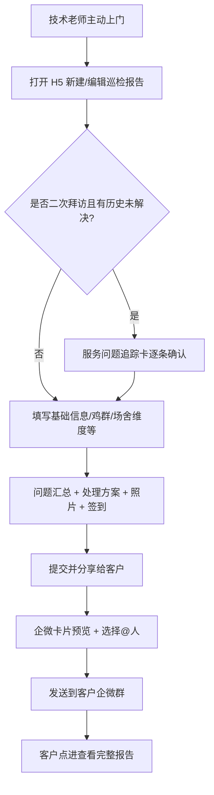
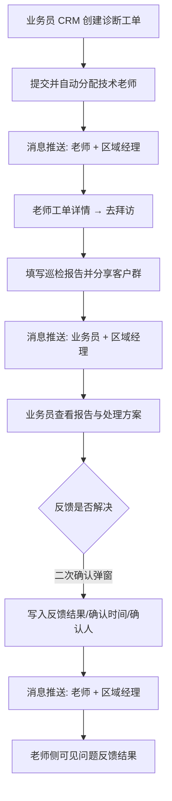
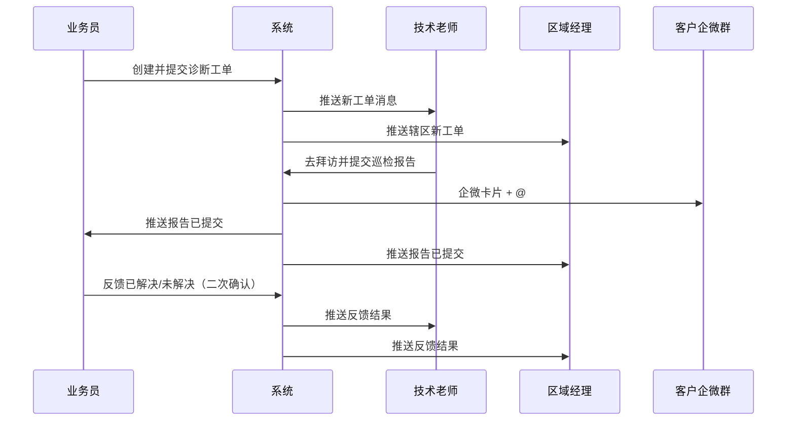

# 【需求】养殖技术老师巡检报告

| 文档版本 | 日期 | 撰写人 | 修改描述 |
| ---- | ----------- | --- | ------ |
| V1.0 | 2026年08月24日 | — | PRD 初稿（对齐原型与公司模板） |

**原型索引**

| 文件 | 说明 |
| --- | --- |
| `养殖技术服务报告V2.html` | 巡检报告填写、分享、客户查看 |
| `技术服务需求接单_原型.html` | 诊断工单提需、列表、详情、反馈闭环 |
| `消息通知.html` | 三类推送消息与跳转 |
| `crm-temp/crm_customerlsit.html` | CRM 客户列表，创建诊断工单入口 |

---

## 1. 背景和目标

### 1.1 背景

技术老师拜访客户后缺少统一、规范的服务输出物，主动服务难量化、难复盘；客户侧也缺少可感知的服务触达，难以形成「被持续服务」的体验。

同时，业务员发现现场问题后，缺少标准化提需与诊断闭环：工单分配、诊断进度、报告结果、问题解决反馈不可见，区域经理亦难感知辖区服务进度。

### 1.2 目标

1. 技术老师主动拜访或响应工单后，可在 H5 填写规范**巡检报告**，并一键分享至**客户企微群**（卡片 + @），完成服务留痕与客户触达。  
2. 业务员可从 CRM 创建诊断工单，系统自动分配技术老师；诊断过程关键节点有消息通知，业务员可对「是否解决」反馈闭环。  
3. 二次拜访自动带出上次未解决问题，逐条确认状态，形成问题追踪。  
4. MVP 先看：**发送到客户企微群的卡片数量**、工单闭环率、三类消息推送成功数。

### 1.3 目标用户（受众）

| 角色 | 用途 |
| --- | --- |
| 养殖技术老师 | 主动拜访 / 响应工单，填写巡检报告，分享至客户群 |
| 业务员 | CRM 创建诊断工单、查看报告、反馈问题是否解决 |
| 区域经理 | 接收辖区工单 / 报告 / 反馈类消息，查看工单详情 |
| 客户群相关人 | 接收企微卡片，查看完整报告 |

### 1.4 业务价值

| 维度 | 说明 |
| --- | --- |
| 对内（老师） | 标准化填报，降低随意性；主动拜访与工单诊断统一报告形态 |
| 对内（业务员） | CRM 一键提需 → 自动分配 → 看报告 → 反馈是否解决 |
| 对内（区域经理） | 辖区进度可感知 |
| 对外（客户） | 企微群收到可读报告，感知粮巴巴持续服务 |
| 品牌 | 强化技术服务形象与信任感 |

### 1.5 名词释义

| 名词 | 说明 |
| --- | --- |
| 巡检报告 / 巡场报告 | 技术老师拜访后填写的规范服务报告（同一套结构） |
| 诊断工单 | 业务员创建、自动分配老师的服务需求单 |
| 未诊断 / 已诊断 | 老师是否已完成拜访并提交报告 |
| 待反馈 / 待确认 | 业务员尚未对「是否解决」表态 |
| 服务问题追踪卡 | 二次拜访时，带出上次未解决项并确认状态 |

---

## 2. 需求方案

### 2.1 功能流程图

#### 流程 A：技术老师主动拜访（无工单）



#### 流程 B：业务员创建工单 → 老师诊断 → 反馈闭环



### 2.2 需求列表

| 分类（产品模块） | 主要功能点 | 功能点拆分 | 优先级 |
| -------- | ----- | --------- | -------- |
| 巡检报告 | 报告列表 | 历史报告列表、进入编辑/查看 | P0 |
| 巡检报告 | 报告编辑 | 基础信息、鸡群信息、场舍检查、维度正常/异常、问题汇总、处理方案、问题照片、现场签到 | P0 |
| 巡检报告 | 二次拜访追踪 | 带出上次未解决项、逐条确认已解决/仍未解决 | P0 |
| 巡检报告 | 企微分享 | 卡片预览、@指定人、发送客户群、统计发送次数 | P0 |
| 巡检报告 | 客户查看页 | 异常优先展示、只读详情 | P0 |
| 诊断工单 | 创建工单 | CRM 入口、客户锁定、需求类型/说明、自动分配老师 | P0 |
| 诊断工单 | 双角色列表 | 未诊断/已诊断 Tab；业务员待反馈/已解决/未解决；老师待确认/已解决/未解决 | P0 |
| 诊断工单 | 工单详情 | 需求说明、巡场报告摘要、去拜访、问题反馈（二次确认且不可改） | P0 |
| 消息通知 | 三类推送 | 提交工单、提交报告、业务员反馈；按角色 inbox；点击跳转详情 | P0 |
| 巡检报告 | 阅读量分析 | 客户打开详情阅读统计 | P2 |
| 诊断工单 | 改派/抢单 | 多老师改派、抢单 | P2 |
| 诊断工单 | 反馈撤回 | 确认后修改/撤回 | ~~不做（确认后不可改）~~ |

### 2.3 交互图

#### 路径 1：主动拜访

```
报告列表 → 新建/打开报告 → 填写各模块
  →（二次拜访）确认历史未解决
  → 【提交并分享给客户】 → 企微卡片预览 → 勾选@人 → 【发送到客户企微群】
  → 客户群卡片 → 【查看详情】 → 客户查看页
```

#### 路径 2：工单诊断

```
CRM 客户列表 → 【创建诊断工单】 → 填写 → 【提交给技术老师】
  → 消息（老师/经理）→ 老师工单详情 → 【去拜访】 → 填写报告并发送客户群
  → 消息（业务员/经理）→ 业务员工单详情 → 查看报告 → 【已解决/未解决】
  → 二次确认弹窗 → 【确认】 → 消息（老师/经理）→ 老师详情见反馈结果
```

#### 时序（工单场景）



---

## 3. 需求明细

> 核心：**左图右逻辑**。左侧为原型页面/状态说明，右侧为业务规则。  
> 原型路径：`trae/养殖技术服务工具/`

### 3.1 巡检报告 · 报告列表

| 页面 | 逻辑 |
| --- | --- |
| **报告列表**<br/>原型：`养殖技术服务报告V2.html` → `screen-list`<br/>状态：有历史报告列表 | **1. 入口**<br/>- 老师端 H5 服务报告首页<br/><br/>**2. 页面字段与规则**<br/>- 展示历史拜访巡检报告（客户、日期等）<br/><br/>**3. 操作与跳转**<br/>- 点击列表项 → 进入报告编辑<br/>- 【客户查看】→ 客户查看页预览<br/><br/>**4. 审批流程**<br/>- 无<br/><br/>**5. 消息通知**<br/>- 无<br/><br/>**6. 边界与异常**<br/>- 空列表时展示空态提示（实现时补齐）<br/><br/>**7. 数据字段**<br/>- 报告 ID、客户、汇报日期、状态（编辑中/已发送） |

### 3.2 巡检报告 · 报告编辑

| 页面 | 逻辑 |
| --- | --- |
| **报告编辑**<br/>原型：`screen-report`<br/>模块：基础信息 → 鸡群信息 → 场舍检查 → 追踪卡 → 问题汇总 → 处理方案 → 问题照片 → 现场签到 | **1. 入口**<br/>- 报告列表进入；或工单详情【去拜访】进入（带客户/工单上下文）<br/><br/>**2. 页面字段与规则**<br/><br/>**基础信息**<br/>- 服务客户、技术官、汇报日期、拜访次数（第 N 次拜访）<br/><br/>**鸡群信息**<br/>- 养殖类型*、养殖品种*、合作规模*（万羽）<br/>- 维度：精神状态*、粪便*、产蛋率/蛋品情况/体重均匀度（**三选一**）、采食与喂料（选填）、死淘状况（选填）、加药情况（选填）<br/><br/>**养殖场舍检查（必填 4 项）**<br/>- 环控设施*、水线与供水*、饲料仓储情况*、其他工作*<br/><br/>**维度填写**<br/>- 点维度打开底部 Sheet：正常/异常；异常必填问题描述<br/>- 列表展示：正常/异常/已填写 标签<br/><br/>**服务问题追踪卡**<br/>- 仅二次拜访且存在历史未解决时展示<br/>- 逐条【已解决】【仍未解决】；未确认完不可提交<br/><br/>**问题汇总**<br/>- 自动汇总本次标记为异常的维度问题<br/><br/>**处理方案***<br/>- 多行文本，整体处理建议<br/><br/>**问题照片***<br/>- 最多 10 张；可提供参考图说明<br/><br/>**现场签到**<br/>- 拜访方式*：实地拜访 / 电话<br/>- 实地：签到地址*、签到照片*、自拍照片*（需含人脸和工服标识）<br/>- 电话：隐藏签到相关字段<br/><br/>**3. 操作与跳转**<br/>- 维度行点击 → Sheet【取消】【保存】<br/>- 【提交并分享给客户】→ 分享预览页<br/><br/>**4. 审批流程**<br/>- 无<br/><br/>**5. 消息通知**<br/>- 主动拜访：仅推客户群<br/>- 工单场景：提交报告后推业务员、区域经理（见 3.7）<br/><br/>**6. 边界与异常**<br/>- 必填未完成不可提交，Toast 提示缺项<br/>- 三选一未选不可提交<br/>- 电话拜访不校验定位与签到照片<br/><br/>**7. 数据字段**<br/>- 见附录「巡检维度清单」与报告主表字段 |

### 3.3 巡检报告 · 分享预览（企微卡片）

| 页面 | 逻辑 |
| --- | --- |
| **分享预览**<br/>原型：`screen-share`<br/>企微卡片预览 + @ 指定人员 | **1. 入口**<br/>- 报告编辑页【提交并分享给客户】<br/><br/>**2. 页面字段与规则**<br/>- 卡片标题：养殖服务报告 · {场舍/客户}<br/>- 服务日期、技术老师<br/>- 异常问题条数 · 未解决条数（>0 时突出）<br/>- @ 人员摘要<br/>- 底部「查看详情」链至客户查看页<br/>- @ 指定人员：多选 Tag，**至少选 1 人**<br/><br/>**3. 操作与跳转**<br/>- 【发送到客户企微群】→ 发送成功 Toast；记一次「发送卡片」<br/>- 返回报告列表/工单详情（工单场景回写已诊断）<br/><br/>**4. 审批流程**<br/>- 无<br/><br/>**5. 消息通知**<br/>- 客户群：企微卡片 + @<br/>- 工单场景：同步站内/推送消息给业务员、区域经理<br/><br/>**6. 边界与异常**<br/>- 未选 @ 人不可发送<br/>- 企微发送失败：提示重试，报告可保留已提交草稿态（实现细化）<br/><br/>**7. 数据字段**<br/>- 发送时间、发送人、@人列表、卡片链接、关联报告 ID、关联工单 ID（可空） |

### 3.4 巡检报告 · 客户查看页

| 页面 | 逻辑 |
| --- | --- |
| **客户查看报告**<br/>原型：`screen-customer`<br/>只读；异常优先 | **1. 入口**<br/>- 企微卡片【查看详情】；老师端预览入口<br/><br/>**2. 页面字段与规则**<br/>展示顺序：<br/>1. 基础信息<br/>2. 鸡群异常信息<br/>3. 场舍巡检异常维度<br/>4. 问题图片<br/>5. 处理方案<br/>6. 正常巡检维度<br/>7. 鸡群信息（完整）<br/><br/>**3. 操作与跳转**<br/>- 只读，无编辑<br/><br/>**4～5.** 无审批；无额外消息<br/><br/>**6. 边界与异常**<br/>- 链接失效/无权限：提示无法查看<br/><br/>**7. 数据字段**<br/>- 与报告只读快照一致 |

### 3.5 诊断工单 · 创建工单

| 页面 | 逻辑 |
| --- | --- |
| **创建养殖诊断工单**<br/>原型：`screen-sales-submit`<br/>入口来自 CRM | **1. 入口**<br/>- CRM 客户列表【创建诊断工单】（URL 带 customer，客户名锁定）<br/>- Hub「业务员 · 提需」进入 CRM<br/><br/>**2. 页面字段与规则**<br/>- 客户名称*（CRM 带入可锁定）<br/>- 需求类型*：客户纠纷 / 鸡群诊断（默认鸡群诊断）<br/>- 需求说明*<br/><br/>**3. 操作与跳转**<br/>- 【提交给技术老师】→ 自动分配技术老师（如王玉东），**无需接单**<br/>- 跳转业务员工单列表<br/><br/>**4. 审批流程**<br/>- 无<br/><br/>**5. 消息通知**<br/>- 推送技术老师、区域经理（新诊断工单）<br/><br/>**6. 边界与异常**<br/>- 必填为空不可提交<br/><br/>**7. 数据字段**<br/>- 工单 ID、客户、类型、说明、业务员、提交时间、老师、visited=false、resolveStatus="" |

### 3.6 诊断工单 · 列表与详情

| 页面 | 逻辑 |
| --- | --- |
| **业务员/老师工单列表**<br/>`screen-sales-list` / `screen-teacher-inbox`<br/>Tab：未诊断 / 已诊断<br/><br/>**工单详情**<br/>`screen-sales-detail` / `screen-teacher-task` | **1. 入口**<br/>- Hub 业务员/老师工单列表；消息点击跳转详情<br/><br/>**2. 页面字段与规则**<br/><br/>**列表状态 Tag**<br/>- 业务员已诊断：待反馈 / 问题已解决 / 问题未解决<br/>- 老师已诊断：待确认 / 业务员反馈已解决 / 业务员反馈未解决<br/><br/>**详情公共字段**<br/>- 业务员、客户、提交时间、需求类型、状态、技术老师、拜访时间（已诊断）<br/>- 需求说明<br/>- 巡场报告：处理方案 + 【查看详情】（跳转报告客户/详情页）<br/><br/>**老师详情 · 问题反馈模块**（已诊断后）<br/>- 待确认：仅显示反馈结果=待确认<br/>- 已反馈：反馈结果、确认时间、确认人（样式对齐业务员侧）<br/>- 未诊断显示【去拜访】；已诊断隐藏<br/><br/>**业务员详情 · 问题反馈模块**（已诊断后）<br/>- 待反馈：【已解决】【未解决】+ 提示「确认后不可修改」<br/>- 点击 → 二次确认弹窗 → 【确认】生效 / 【取消】关闭<br/>- 确认后只读：反馈结果、确认时间、确认人；**不可再改**<br/><br/>**3. 操作与跳转**<br/>- 列表行 → 详情<br/>- 【去拜访】→ 报告填写<br/>- 【查看详情】→ 报告页<br/>- 【已解决】【未解决】→ 确认弹窗 → 写回列表状态<br/><br/>**4. 审批流程**<br/>- 无<br/><br/>**5. 消息通知**<br/>- 反馈确认后推送老师、区域经理<br/><br/>**6. 边界与异常**<br/>- 已反馈再次操作：Toast「已确认，不可修改」<br/>- 未诊断不展示反馈模块<br/><br/>**7. 数据字段**<br/>- `visited`、`resolveStatus`（""/ok/no）、`resolveConfirmTime`、`resolveConfirmBy`、`feedback`（处理方案）、`visitTime` |

### 3.7 消息通知

| 页面 | 逻辑 |
| --- | --- |
| **消息通知**<br/>原型：`消息通知.html`<br/>角色 Tab：技术老师 / 业务员 / 区域经理<br/>消息中心列表（未读红点） | **1. 入口**<br/>- Hub【消息通知】；系统推送点击<br/><br/>**2. 页面字段与规则**<br/><br/>| 触发节点 | 推送对象 | 示例 | 跳转 |<br/>| 业务员提交工单 | 老师、经理 | 新诊断工单待处理 | 老师工单详情 |<br/>| 老师提交巡检报告 | 业务员、经理 | 巡场报告已提交 | 业务员工单详情 |<br/>| 业务员反馈 | 老师、经理 | 问题反馈：已解决/未解决 | 老师工单详情 |<br/><br/>**3. 操作与跳转**<br/>- 点击消息 → 标记已读 → 带 demandId 打开对应详情<br/><br/>**4. 审批流程**<br/>- 无<br/><br/>**5. 消息通知**<br/>- 本模块即站内消息 + 推送样式示意<br/><br/>**6. 边界与异常**<br/>- 工单已删除：提示资源不存在<br/><br/>**7. 数据字段**<br/>- 消息 ID、scene（submit/report/feedback）、收件角色、标题、正文、未读、关联工单 ID |

---

## 4. 边界异常场景

| 场景 | 处理 |
| --- | --- |
| 报告必填项未完成 | 不可提交；Toast 提示具体缺项（维度/方案/照片/签到等） |
| 产蛋率/蛋品/体重三选一未选 | 不可提交 |
| 电话拜访 | 不校验签到地址与签到/自拍照片 |
| 二次拜访追踪卡未全部确认 | 不可提交 |
| 企微分享未选 @ 人 | 不可发送 |
| 企微发送失败 | 提示重试；保留报告内容 |
| 业务员已反馈后再次点击 | Toast「已确认，不可修改」；无修改入口 |
| 未诊断工单打开反馈模块 | 不展示问题反馈卡片 |
| 消息跳转工单不存在 | 提示无效链接 |
| 客户查看链接过期/无权限 | 提示无法查看 |
| 主动拜访无工单 | 仅报告 + 客户群；不推业务员反馈链路 |
| 工单改派/抢单/反馈撤回 | 本期不做 |

---

## 5. 数据统计

### 5.1 核心指标

| 指标名称 | 定义 | 计算口径 | 统计周期 | 备注 |
| ---- | --- | ---- | ---- | --- |
| 报告发送卡片数 | 服务触达次数 | 成功发送到客户企微群的卡片次数；分子=成功发送数 | 日/周/月 | MVP 主指标 |
| 工单闭环率 | 已诊断后业务员完成反馈比例 | 分母=已诊断工单数；分子=resolveStatus 为 ok 或 no 的工单数 | 周/月 | |
| 待反馈工单数 | 已诊断未反馈积压 | visited=true 且 resolveStatus 为空 | 实时/日 | |
| 消息推送成功数 | 三类关键节点触达 | 按 scene（submit/report/feedback）分别计数成功推送 | 日/周 | |
| 未解决问题数 | 追踪卡仍未解决项 | 报告维度/追踪项 status=未解决 条数 | 周 | |

> 客户阅读量：本期不做强依赖，列为 P2。

### 5.2 埋点（如有）

| 事件 | 触发时机 | 关键属性 |
| --- | --- | --- |
| report_submit_share | 点击提交并分享 | 报告 ID、客户 ID、是否工单关联 |
| report_send_wecom | 企微发送成功/失败 | 报告 ID、@人数、结果 |
| order_create | 工单提交成功 | 工单 ID、类型、老师 ID |
| order_feedback | 业务员确认反馈 | 工单 ID、结果 ok/no |
| msg_click | 点击消息 | 消息 ID、scene、角色 |

### 5.3 列表/导出字段（建议）

| 对象 | 字段 |
| --- | --- |
| 报告列表 | 报告 ID、客户、老师、汇报日期、拜访次数、异常数、未解决数、是否已发送、发送时间 |
| 工单列表 | 工单 ID、客户、业务员、老师、类型、提交时间、是否已诊断、反馈结果、确认时间、确认人 |
| 消息列表 | 消息 ID、scene、收件人角色、标题、时间、是否已读、关联工单 |

### 5.4 企微/消息口径

| 类型 | 口径 |
| --- | --- |
| 企微卡片 | 发送成功记 1 次「报告发送卡片数」；失败不计 |
| 站内消息 | 按收件人去重计数；同一事件多角色各记一条 |
| @ 人 | 卡片正文展示已选人员；至少 1 人 |

### 5.5 外部系统对接

| 系统 | 对接内容 |
| --- | --- |
| CRM | 客户列表入口创建工单；带入客户名 |
| 企业微信 | 客户群卡片发送、@、详情 H5 链接 |
| 消息中心/推送 | 三类业务消息推送与跳转 |

---

## 6. 附录

### 6.1 巡检维度清单

| # | 维度 | 所属模块 | 规则 |
| --- | --- | --- | --- |
| 0 | 环控设施（含温湿度/通风） | 场舍检查 | 必填 |
| 1 | 精神状态 | 鸡群信息 | 必填 |
| 2 | 水线与供水 | 场舍检查 | 必填 |
| 3 | 粪便 | 鸡群信息 | 必填 |
| 4 | 饲料仓储情况 | 场舍检查 | 必填 |
| 5 | 其他工作 / 其他 | 场舍检查 | 必填 |
| 6 | 产蛋率 | 鸡群信息 | 三选一 |
| 7 | 蛋品情况 | 鸡群信息 | 三选一 |
| 8 | 体重/均匀度 | 鸡群信息 | 三选一 |
| 9 | 采食与喂料 | 鸡群信息 | 选填 |
| 10 | 死淘状况 | 鸡群信息 | 选填 |
| 11 | 加药情况 | 鸡群信息 | 选填 |

### 6.2 全局约束

- 平台：移动端 H5；企微内置浏览器可打开。  
- 权限：老师看自己工单/报告；业务员看辖区客户工单；经理看辖区消息。  
- 反馈确认后不可修改。  
- 创建工单即自动分配老师，无接单环节。

### 6.3 MVP / 暂不做

**MVP：** 报告填报 + 二次拜访追踪 + 企微卡片发送 + 客户查看 + CRM 提需自动分配 + 双角色工单与反馈 + 三类消息推送  

**暂不做：** 客户阅读量强依赖、复杂看板、非企微渠道、工单改派/抢单、反馈撤回、老师日程独立入口  

### 6.4 风险控制

| 风险 | 应对 |
| --- | --- |
| 企微发送失败导致客户未触达 | 失败重试 + 发送状态可查 |
| 业务员误点反馈且不可改 | 二次确认弹窗；文案提示确认后不可修改 |
| 老师漏填维度导致报告质量差 | 必填校验 + 三选一规则 + 异常汇总可见 |
| 消息轰炸 | 仅关键三节点推送；按角色收件 |
