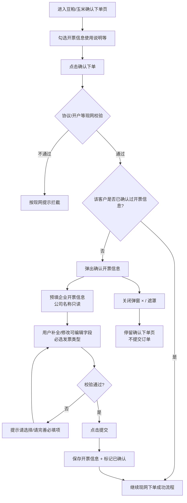
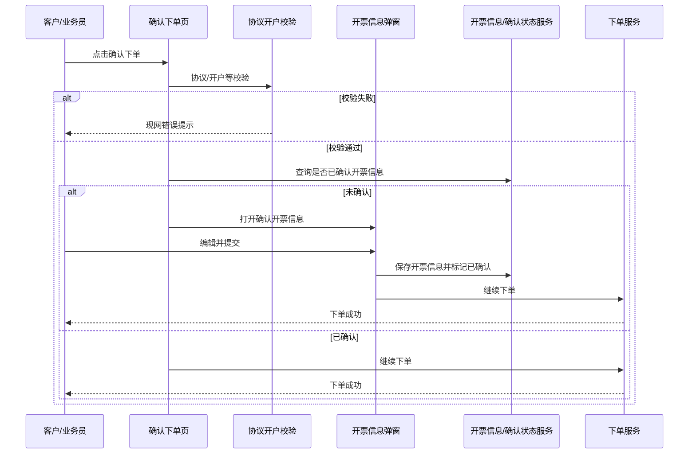

# 【需求】大宗下单确认开票信息

| 文档版本 | 日期 | 撰写人 | 修改描述 |
| ---- | ----------- | --- | ------ |
| V1.0 | 2026年09月04日 | AI辅助 | 初稿；对齐已确认 HTML 原型 |

**关联原型**

| 原型文件 | 说明 |
| ---- | ---- |
| `豆粕确认下单-开票信息确认.html` | 确认下单页 + 首次开票信息确认弹窗（空态/可演示首次与已确认） |
| `确认开票信息-已填写.html` | 开票信息弹窗已填写态参考 |
| 发票中心·开票信息（现网/附件截图） | 收票信息字段与多邮箱交互参考 |

**适用范围**：大宗 **豆粕**、**玉米** 确认下单页；含客户自主下单与业务员代下单。

---

## 1. 背景和目标

### 1.1 背景

- 企业客户开票信息目前由系统根据**营业执照**自动生成，且历史上默认开**专票**。
- 少部分客户实际只要**普票**；财务按默认专票开出后，客户要求红冲重开。
- 财务侧已不允许随意红冲，导致客诉与对账成本上升。
- 痛点：首次与平台成交时，客户/业务员未在下单环节主动确认发票类型与收票信息，错误成本后移到开票环节。

### 1.2 目标

- 首次在平台成交（自主下单或代下单）时，在确认下单流程中**强制确认开票信息**。
- 发票类型**不默认**，由用户主动选择普票/专票，降低错开票概率。
- 确认成功后落库「已确认」标识，**后续下单不再弹窗**。
- 豆粕、玉米确认下单链路行为一致。

### 1.3 受众

| 角色 | 使用场景 |
| ---- | ---- |
| 企业客户（买家） | 自主确认下单时确认开票信息 |
| 业务员 | 代客户下单时确认/核对开票信息 |
| 财务 | 按确认后的开票信息开票，减少红冲 |
| 研发/测试 | 开发与验收 |

### 1.4 名词释义

| 名词 | 说明 |
| ---- | ---- |
| 首次确认开票信息 | 该企业客户在平台维度尚未完成过开票信息确认 |
| 已确认 | 客户/业务员在弹窗中【提交】成功后的状态；后续下单跳过弹窗 |
| 协议/开户校验 | 现网确认下单前已有的协议签署、开户等相关校验；本需求弹窗在其后触发 |
| 代下单 | 业务员代替客户在下单页提交订单 |
| 普票 / 专票 | 增值税普通发票 / 增值税专用发票 |

---

## 2. 需求方案

### 2.1 功能流程图



### 2.2 需求列表

| 分类（产品模块） | 主要功能点 | 功能点拆分 | 优先级 |
| -------- | ----- | --------- | -------- |
| 大宗·确认下单 | 首次开票信息确认弹窗 | **新增需求：**<br/>协议/开户校验通过后触发<br/>未确认则弹窗，已确认则跳过<br/>豆粕、玉米一致<br/>自主下单与代下单均适用 | P0 |
| 大宗·开票信息弹窗 | 企业开票信息 | **新增需求：**<br/>公司名称只读展示<br/>信用代码/注册地址/注册电话/开户银行/银行账户可编辑，系统预填可改 | P0 |
| 大宗·开票信息弹窗 | 发票类型 | **新增需求：**<br/>普票/专票双选项单选<br/>**不默认**任一选项<br/>未选提交提示「请选择」 | P0 |
| 大宗·开票信息弹窗 | 收票信息 | **新增需求：**<br/>收件邮箱（可增加多个，可删除）<br/>收票人姓名、收票人手机号<br/>收票地址、收票详细地址 | P0 |
| 大宗·开票信息弹窗 | 提交与落库 | **新增需求：**<br/>底部单按钮【提交】<br/>成功后标记已确认并继续下单 | P0 |

### 2.3 交互图

**主路径（首次客户 / 代下单首次）**

```
确认下单页 →【确认下单】→ 协议/开户校验通过 → 确认开票信息弹窗
→ 核对企业信息 + 选择发票类型 + 填写收票信息 →【提交】→ 落库已确认 → 下单成功
```

**主路径（已确认客户）**

```
确认下单页 →【确认下单】→ 协议/开户校验通过 → 已确认开票信息 → 直接走现网下单
```

**放弃确认**

```
确认开票信息弹窗 →【×】或点遮罩关闭 → 返回确认下单页（订单未提交）
```



---

## 3. 需求明细

| 页面 | 逻辑 |
| ---- | ---- |
| **确认下单页（豆粕/玉米）**<br/><br/>原型：`豆粕确认下单-开票信息确认.html`<br/><br/>底部保留现网勾选文案：「您的个人或企业信息将用于商家开票使用」+【确认下单】 | **1. 入口**<br/>大宗豆粕/玉米确认下单页；自主下单与代下单同一套逻辑。<br/><br/>**2. 页面字段与规则**<br/>- 点击【确认下单】后：先走现网**协议、开户**等校验；**全部通过后**再判断是否弹出开票信息确认。<br/>- 判断维度：企业客户在平台侧「开票信息是否已确认」。<br/>  - 未确认 → 弹出「确认开票信息」，**暂不提交订单**。<br/>  - 已确认 → 不弹窗，按现网继续下单。<br/>- 豆粕、玉米行为一致。<br/><br/>**3. 操作与跳转**<br/>- 【确认下单】→ 校验 →（条件满足）开票弹窗或下单。<br/><br/>**4. 审批流程**<br/>无。<br/><br/>**5. 消息通知**<br/>无（本需求不新增）。<br/><br/>**6. 边界与异常**<br/>- 未勾选开票使用说明：按现网/原型拦截，不可下单。<br/>- 弹窗关闭后订单未提交，可再次点【确认下单】重新触发。<br/><br/>**7. 数据字段**<br/>依赖客户ID/企业主体维度的「开票信息确认状态」标识。 |
| **确认开票信息弹窗**<br/><br/>原型：`豆粕确认下单-开票信息确认.html` / `确认开票信息-已填写.html`<br/><br/>标题：确认开票信息<br/>顶栏说明：您的个人或企业信息将用于开票使用。首次下单需确认开票信息<br/>底部：【提交】（单按钮） | **1. 入口**<br/>确认下单且协议/开户校验通过、且未确认开票信息时弹出。<br/><br/>**2. 页面字段与规则**<br/><br/>**企业开票信息**<br/><br/>\| 字段 \| 必填 \| 规则 \|<br/>\| ---- \| ---- \| ---- \|<br/>\| 公司名称 \| 是 \| **只读**，灰色纯文本展示；来源于营业执照/系统生成，**不允许修改** \|<br/>\| 信用代码 \| 是 \| 可编辑；系统预填，可改 \|<br/>\| 注册地址 \| 是 \| 可编辑；系统预填，可改 \|<br/>\| 注册电话 \| 是 \| 可编辑；系统预填，可改 \|<br/>\| 开户银行 \| 是 \| 可编辑；系统预填，可改 \|<br/>\| 银行账户 \| 是 \| 可编辑；系统预填，可改 \|<br/><br/>**发票类型**<br/>- 选项：增值税普通发票、增值税专用发票（并排单选按钮）。<br/>- **不默认选中**任一选项。<br/>- 必选；未选点【提交】提示「请选择」。<br/><br/>**收票信息**<br/><br/>\| 字段 \| 必填 \| 规则 \|<br/>\| ---- \| ---- \| ---- \|<br/>\| 收件邮箱 \| 是 \| 支持【增加邮箱】追加多条；附加行提供【删除】；每条必填且校验邮箱格式；建议上限与发票中心一致（主邮箱 + 附加，最多 5 个） \|<br/>\| 收票人姓名 \| 是 \| 文本 \|<br/>\| 收票人手机号 \| 是 \| 11 位手机号格式校验 \|<br/>\| 收票地址 \| 是 \| 省市区选择器；占位「请选择所在地区」 \|<br/>\| 收票详细地址 \| 是 \| 文本 \|<br/><br/>**3. 操作与跳转**<br/>- 【提交】：校验全部必填与格式 → 保存开票信息 → 标记「已确认」→ 关闭弹窗 → **继续完成当次下单**。<br/>- 【×】/点击遮罩：关闭弹窗，**不保存确认状态、不提交订单**。<br/><br/>**4. 审批流程**<br/>无。<br/><br/>**5. 消息通知**<br/>无。<br/><br/>**6. 边界与异常**<br/>- 必填为空：标红并 Toast「请完善必填的开票信息」。<br/>- 发票类型未选：展示「请选择」。<br/>- 邮箱/手机格式错误：对应字段标红并提示。<br/>- 网络失败：提示重试，不标记已确认、不提交订单。<br/><br/>**7. 数据字段**<br/>见 §5.3；确认状态与开票信息落库后，发票中心侧应可读到最新数据（与现网开票信息打通，具体接口由研发评估）。 |

---

## 4. 边界/异常场景

| 场景 | 处理 |
| ---- | ---- |
| 已确认过开票信息的客户再次下单 | 不弹窗，直接走现网下单 |
| 协议或开户校验未通过 | 不弹开票信息窗，按现网拦截 |
| 弹窗关闭后再次点确认下单 | 若仍未确认，再次弹出 |
| 公司名称与营业执照不一致诉求 | 本需求不允许改公司名称；需走线下/现有变更通道（若有） |
| 仅改发票类型、其他不变 | 允许；类型仍须主动选择后提交 |
| 代下单 | 与自主下单同一弹窗与确认状态（按客户/企业主体维度，不以业务员维度） |
| 豆粕已确认、玉米再下单 | 同一客户已确认则玉米也不再弹（平台维度一次确认） |
| 提交成功但下单接口失败 | 开票信息与已确认状态是否回滚：建议**保留已确认与开票信息**，避免重复弹窗；订单失败按现网提示重试下单。待研发确认事务策略 |
| 并发两人同时确认 | 以服务端最终写入为准；第二次提交覆盖或幂等，需防重复下单 |

---

## 5. 数据统计

### 5.1 核心指标

| 指标名称 | 定义 | 计算口径 | 统计周期 | 备注 |
| ---- | --- | ---- | ---- | --- |
| 开票信息确认完成率 | 需确认人群中完成确认的比例 | 完成确认客户数 / 触发过弹窗的客户数 | 日/周 | 评估漏确认 |
| 弹窗曝光次数 | 打开确认开票信息弹窗次数 | count(open) | 日 | |
| 弹窗提交次数 | 点击【提交】且校验通过次数 | count(submit_success) | 日 | |
| 弹窗关闭未提交次数 | 打开后关闭且未成功提交 | count(close_without_submit) | 日 | |
| 发票类型分布 | 确认时选择普票/专票占比 | 按类型分组 | 周/月 | 验证「不默认」是否生效 |

### 5.2 埋点（建议）

| 事件 | 触发 | 关键属性 |
| ---- | ---- | ---- |
| invoice_confirm_show | 弹窗展示 | 客户ID、品类(豆粕/玉米)、是否代下单 |
| invoice_confirm_submit | 提交成功 | 客户ID、发票类型、邮箱数量 |
| invoice_confirm_close | 关闭未提交 | 客户ID、停留时长 |
| invoice_confirm_skip | 已确认跳过弹窗 | 客户ID、品类 |

### 5.3 落库/字段清单

| 字段 | 说明 |
| ---- | ---- |
| company_name | 公司名称（只读来源） |
| tax_no | 信用代码/纳税人识别号 |
| reg_address | 注册地址 |
| reg_phone | 注册电话 |
| bank_name | 开户银行 |
| bank_account | 银行账户 |
| invoice_type | 普票 / 专票（确认时必填，无系统默认） |
| emails[] | 收件邮箱列表（≥1） |
| receiver_name | 收票人姓名 |
| receiver_mobile | 收票人手机号 |
| receiver_region | 收票地址（省市区） |
| receiver_address | 收票详细地址 |
| invoice_confirmed | 是否已确认（bool） |
| confirmed_at / confirmed_by | 确认时间、操作人（客户本人或代下单业务员） |

### 5.4 外部系统对接

| 系统 | 说明 |
| ---- | ---- |
| 营业执照/企业信息 | 预填公司名称（不可改）、信用代码及企业开票字段 |
| 发票中心·开票信息 | 确认后数据应同步/回写，供后续开票使用 |
| 下单服务 | 弹窗提交成功后继续原下单事务 |

---

## 6. 附录

### 6.1 全局约束

1. **触发顺序**：【确认下单】→ 协议/开户等现网校验通过 → 再判断开票信息确认弹窗。
2. **确认一次有效**：平台企业客户维度确认后，豆粕/玉米后续下单均不再弹。
3. **发票类型不默认**：系统不得预选专票或普票。
4. **公司名称不可改**：弹窗内只读展示。
5. 品类范围：本期仅大宗豆粕、玉米确认下单；其他品类若复用需另评。

### 6.2 待确认项

| 项 | 说明 | 建议 |
| ---- | ---- | ---- |
| 确认状态主体 | 按企业主体还是按登录账号 | 建议按**企业主体**（开票抬头） |
| 提交成功但下单失败 | 确认状态是否保留 | 建议保留 |
| 历史已成交未确认客户 | 是否在下次下单补确认 | 建议：**是**（按「未确认」处理） |
| 邮箱数量上限 | 与发票中心是否完全一致 | 建议对齐发票中心（主+附加≤5） |
| 信用代码是否允许修改 | 原型可改 | 需业务确认是否应部分只读 |

### 6.3 风险控制

- 强制确认可能增加首次下单步骤；需保证预填准确、校验提示清晰，缩短填写时间。
- 代下单场景须明确业务员代填的合规与留痕（confirmed_by）。
