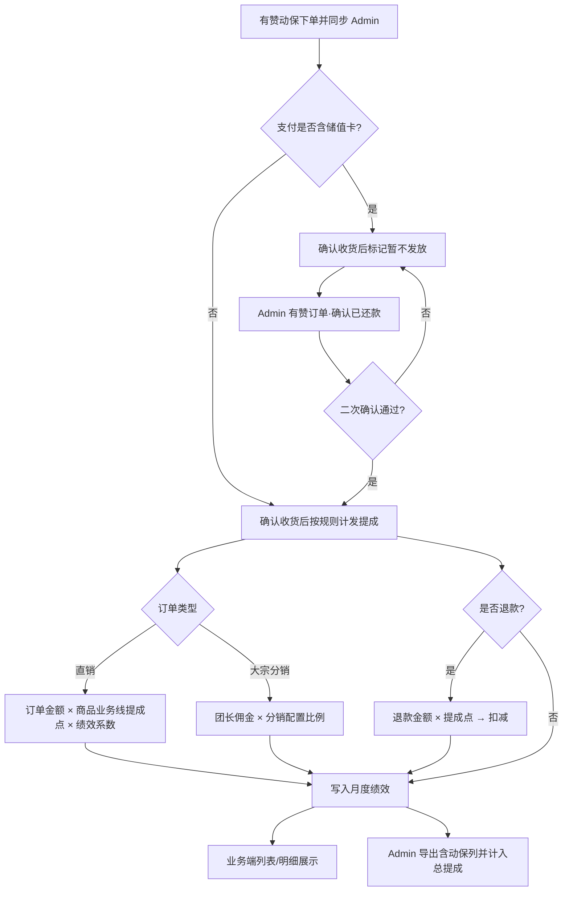
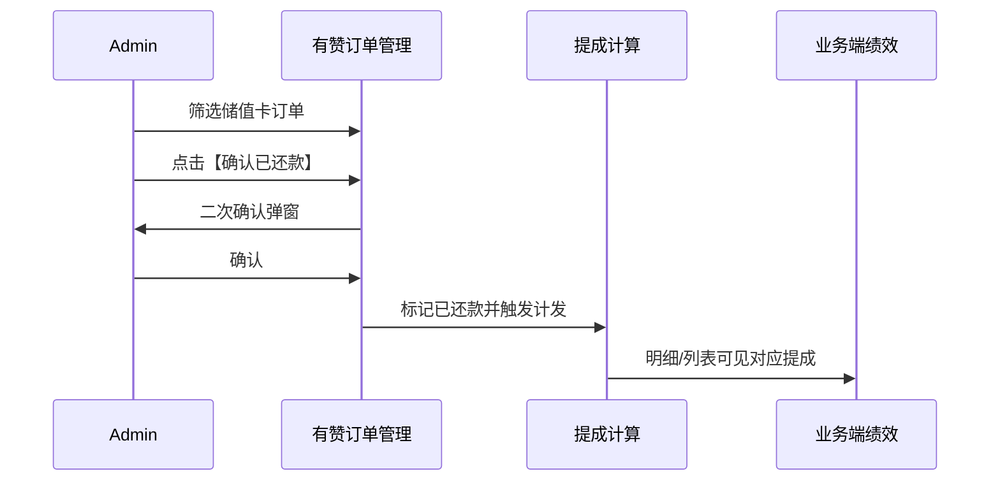

# 【需求】动保提成

| 文档版本 | 日期 | 撰写人 | 修改描述 |
| ---- | ----------- | --- | ------ |
| V1.0 | 2026年09月01日 | AI辅助 | 按《prd模版》重写初稿；对齐已确认原型 |

**关联原型**

| 原型文件 | 说明 |
| ---- | ---- |
| `Admin动保商品提成比例配置.html` | 直销/分销提成比例配置 |
| `Admin有赞订单管理.html` | 支付方式筛选、储值卡字段、确认已还款 |
| `鸡窝绩效列表.html` | 提成模块增加动保提成 |
| `鸡窝动保提成详情.html` | 动保明细（参考预混料提成详情） |
| `鸡窝预混料提成详情.html` | 明细页交互参考 |

---

## 1. 背景和目标

### 1.1 背景

- 动保在**有赞**成交，粮巴巴通过接口将订单同步至 **Admin**。
- 需核算**鸡窝站长/业务员**、**大宗业务员/区域经理**的动保提成，并支持明细核对。
- 当前痛点：
  - 无按商品、业务线（鸡窝/大宗）配置提成比例的能力；
  - 储值卡（含组合支付含储值卡）订单无法在 Admin「确认还款」后再发放；
  - 业务端绩效列表缺少动保提成模块与明细页；
  - 绩效导出不含动保列，总提成未计入动保。

### 1.2 目标

- 动保提成**可配置、可计算、可核对、可导出**。
- 业务可按确认收货时间对账；Admin 可处理储值卡还款确认。
- 直销/分销、储值卡暂不发、退款扣减规则在系统内统一落地。

### 1.3 受众

| 角色 | 使用场景 |
| ---- | ---- |
| Admin 运营/绩效管理员 | 配置比例、有赞订单还款确认、导出绩效 |
| 鸡窝站长/业务员 | 查看绩效列表动保提成及明细 |
| 大宗业务员/区域经理 | 查看管辖范围内动保提成（权限沿用现网） |
| 研发/测试/数据 | 开发、验收、口径对齐 |

### 1.4 名词释义

| 名词 | 说明 |
| ---- | ---- |
| 直销提成比例 | 商品在鸡窝/大宗业务线下配置的提成点（%） |
| 分销 | 大宗分销订单；提成 = 团长佣金 × 分销配置比例（默认 20%），不走直销点 |
| 储值卡支付 | 含纯储值卡，及组合支付中含储值卡 |
| 确认已还款 | Admin 确认储值卡订单已回款后，允许发放对应提成 |
| 激励提成 | 各段提成金额 × 对应绩效系数后的汇总展示 |

---

## 2. 需求方案

### 2.1 功能流程图



### 2.2 需求列表

| 分类（产品模块） | 主要功能点 | 功能点拆分 | 优先级 |
| -------- | ----- | --------- | -------- |
| Admin·提成配置 | 动保商品提成比例配置 | **新增需求：**<br/>直销：商品ID/名称、鸡窝比例、大宗比例、增删改、分页<br/>分销：团长佣金配置比例（默认20%） | P0 |
| Admin·有赞订单 | 订单字段与还款操作 | **新增需求：**<br/>支付方式筛选（微信/储值卡）<br/>储值卡订单展示：佣金金额、确认收货时间、商品ID、商品名称<br/>【确认已还款】+ 二次确认 | P0 |
| Admin·绩效导出 | 导出含动保 | **新增需求：**<br/>鸡窝/大宗导出增加动保提成列<br/>总提成计入动保 | P0 |
| 业务端·绩效列表 | 动保提成模块 | **新增需求：**<br/>提成区增加动保提成汇总<br/>【查看明细】跳转动保明细 | P0 |
| 业务端·动保明细 | 动保提成详情 | **新增需求：**<br/>激励提成展示条<br/>明细表（参考预混料详情）<br/>日期筛选、搜索 | P0 |
| 计算引擎 | 提成规则落地 | 确认收货计期、直销/分销、储值卡暂不发、还款后发放、退款扣减、激励提成 | P0 |

### 2.3 交互图

**主路径（业务员）**

```
鸡窝绩效列表 → 提成·动保提成【查看明细】 → 动保提成详情 → 查看激励提成/明细表 → 搜索过滤
```

**主路径（Admin 配置）**

```
动保商品提成比例配置 → 直销配置【新增/编辑/删除】 → 分销配置【保存团长佣金比例】
```

**主路径（Admin 还款）**

```
有赞订单管理 → 筛支付方式=储值卡 → 【确认已还款】 → 二次确认弹窗【确认已还款】 → 状态变为已还款 → 提成可发放
```



---

## 3. 需求明细

> 左：原型说明｜右：逻辑（入口 / 字段与规则 / 操作 / 边界 / 数据字段）

| 页面 | 逻辑 |
| --------- | ------------- |
| **动保商品提成比例配置**<br/><br/>原型：`Admin动保商品提成比例配置.html`<br/><br/>**直销配置**<br/>表头：商品ID、商品名称、鸡窝提成比例、大宗提成比例、操作<br/>底部分页<br/><br/>**分销配置**<br/>团长佣金配置比例（%）【保存】 | **1. 入口**<br/>Admin 后台 · 动保商品提成比例配置<br/><br/>**2. 页面字段与规则**<br/>- Tab：直销配置 / 分销配置<br/>- 直销：一商品一行；比例 0~100%；商品ID 唯一<br/>- 分销：全局团长佣金比例，默认 20%；分销订单不走直销点<br/><br/>**3. 操作与跳转**<br/>- 【+ 新增配置】【编辑】【删除】【查询】【重置】<br/>- 分销页【保存】<br/><br/>**4. 审批流程**<br/>无<br/><br/>**5. 消息通知**<br/>无<br/><br/>**6. 边界与异常**<br/>- 比例超范围：提示非法<br/>- 重复商品ID：禁止保存<br/><br/>**7. 数据字段**<br/>商品ID、商品名称、鸡窝提成比例%、大宗提成比例%、团长佣金比例% |
| **有赞订单管理**<br/><br/>原型：`Admin有赞订单管理.html`<br/><br/>筛选：收货人、手机号、销售、订单状态、**支付方式（新）**、创建/发货时间<br/><br/>表新增列（高亮）：佣金金额、确认收货时间、商品ID、**商品名称**、操作 | **1. 入口**<br/>Admin · 有赞订单管理<br/><br/>**2. 页面字段与规则**<br/>- **新增**支付方式筛选：微信支付、储值卡支付（组合支付可单独或并入含储值卡逻辑）<br/>- 储值卡相关订单展示佣金金额、确认收货时间、商品ID、商品名称<br/>- 非储值卡上述列可显示 `--`<br/><br/>**3. 操作与跳转**<br/>- 【查询】【重置】<br/>- 【确认已还款】→ 二次确认弹窗 → 【确认已还款】/【取消】<br/>- 已确认后展示灰色【已还款】，不可重复点<br/><br/>**4. 审批流程**<br/>无（二次确认即可）<br/><br/>**5. 消息通知**<br/>无（可选操作日志）<br/><br/>**6. 边界与异常**<br/>- 含储值卡（含组合）均暂不发放，直至确认已还款<br/>- 取消二次确认：状态不变<br/>- 幂等：已还款不可再点<br/><br/>**7. 数据字段**<br/>既有订单字段 + 支付方式、佣金金额、确认收货时间、商品ID、商品名称、是否已还款 |
| **鸡窝绩效列表·提成**<br/><br/>原型：`鸡窝绩效列表.html`<br/><br/>提成区增加「动保提成」模块<br/>已发放金额 + 【查看明细】 | **1. 入口**<br/>业务端 · 鸡窝绩效列表 · 提成 Tab<br/><br/>**2. 页面字段与规则**<br/>- 展示动保提成汇总（已发放等，口径与计算引擎一致）<br/>- 本月总提成**计入动保**<br/><br/>**3. 操作与跳转**<br/>- 【查看明细】→ 动保提成详情<br/><br/>**4. 审批流程**<br/>无<br/><br/>**5. 消息通知**<br/>无<br/><br/>**6. 边界与异常**<br/>- 无动保数据时金额为 0<br/><br/>**7. 数据字段**<br/>动保已发放、（可选）暂不发放/退款扣减摘要、总提成 |
| **动保提成详情**<br/><br/>原型：`鸡窝动保提成详情.html`<br/>参考：`鸡窝预混料提成详情.html`<br/><br/>激励提成灰底条：`激励提成: 1600 = 2000 × 0.5 + 1000 × 0.6`<br/><br/>明细列：客户名称、提成金额、订单金额、确认收货时间、有赞订单号、商品名称、支付方式、分销类型、销售<br/>**不展示**：发放状态、备注、状态筛选条、长提示文案、暂不发放统计卡 | **1. 入口**<br/>绩效列表动保【查看明细】；提成分类 Tab 切到「动保」<br/><br/>**2. 页面字段与规则**<br/>- **激励提成**：每月提成金额 × 绩效系数分段汇总<br/>- 明细按确认收货时间归属月份<br/>- 支持日期区间、客户名/订单号搜索<br/><br/>**3. 操作与跳转**<br/>- 【搜索】；分类 Tab 切豆粕/玉米/预混料跳转原有页<br/><br/>**4. 审批流程**<br/>无<br/><br/>**5. 消息通知**<br/>无<br/><br/>**6. 边界与异常**<br/>- 无数据空态<br/>- 储值卡未还款订单不出现在「已发放」口径中<br/><br/>**7. 数据字段**<br/>见左表明细列；提成金额建议带算式（如 `159.60=799*2%*1`） |
| **绩效导出（鸡窝/大宗）**<br/><br/>（无独立 HTML，字段对齐列表） | **1. 入口**<br/>Admin 鸡窝/大宗绩效模块导出<br/><br/>**2. 页面字段与规则**<br/>- **新增**动保提成列<br/>- 总提成 = 原总提成逻辑 + 动保（已发放 − 退款扣减等，与列表一致）<br/><br/>**3. 操作与跳转**<br/>- 【导出】<br/><br/>**6. 边界与异常**<br/>- 无动保时列值为 0<br/><br/>**7. 数据字段**<br/>动保提成、总提成（含动保） |

### 3.1 提成计算规则（全局）

| 规则项 | 说明 |
| ---- | ---- |
| 计期 | 按**确认收货时间**计入对应月绩效 |
| 直销 | 确认收货订单金额 × 该商品对应业务线提成点 × 当月绩效系数 |
| 大宗分销 | 团长佣金 × 分销配置比例（默认 20%），**不走**直销提成点 |
| 储值卡/含储值卡 | **暂不发放**；Admin【确认已还款】后再发放 |
| 退款 | 退款金额 × 提成点，生成扣减 |
| 激励提成 | ∑（提成金额 × 对应绩效系数），详情页灰底条展示 |

---

## 4. 边界异常场景

| 场景 | 预期处理 |
| ---- | ---- |
| 商品未配置提成比例 | 不计发或记 0，并告警待配置（**待确认**） |
| 组合支付含储值卡 | 整单按「含储值卡」暂不发放，直至确认已还款 |
| 重复确认已还款 | 按钮置为【已还款】，接口幂等 |
| 二次确认点【取消】 | 订单状态不变 |
| 分销但团长佣金字段缺失 | 不计发 + 告警（**待确认**） |
| 业务员无管辖数据 | 明细空态 |
| 导出时无动保 | 动保列填 0，总提成不受影响以外的部分保持原逻辑 |

---

## 5. 数据统计

### 5.1 核心指标

| 指标名称 | 定义 | 计算口径 | 统计周期 | 备注 |
| ---- | --- | ---- | ---- | ---- |
| 动保提成核算准确率 | 抽样账实一致比例 | 一致笔数 / 抽样笔数 | 月 | 北极星 |
| 储值卡待还款积压 | 确认收货且未确认还款订单数 | 过滤支付含储值卡且未还款 | 日 | |
| 动保明细访问量 | 打开动保提成详情次数 | 埋点计数 | 周/月 | |

### 5.2 埋点（如有）

| 事件名称 | 触发时机 | 携带参数 | 目的 |
| ---- | ---- | ---- | ---- |
| animal_rate_config_save | 保存直销/分销配置 | 商品ID/比例或分销比例 | 配置活跃 |
| youzan_repay_confirm | 确认已还款成功 | 订单号 | 还款转化 |
| animal_comm_detail_view | 打开动保明细 | 用户ID、月份 | 使用度 |
| animal_comm_export | 导出含动保 | 业务线、月份 | 导出使用 |

### 5.3 列表/导出字段

| 场景 | 字段 |
| ---- | ---- |
| 直销配置表 | 商品ID、商品名称、鸡窝提成比例、大宗提成比例 |
| 分销配置 | 团长佣金配置比例 |
| 有赞订单（新增） | 支付方式、佣金金额、确认收货时间、商品ID、商品名称、是否已还款 |
| 动保明细表 | 客户名称、提成金额、订单金额、确认收货时间、有赞订单号、商品名称、支付方式、分销类型、销售 |
| 绩效导出（新增） | 动保提成；总提成（含动保） |

### 5.4 外部系统对接

| 系统 | 方向 | 内容 |
| ---- | ---- | ---- |
| 有赞 → Admin | 入 | 订单、支付方式、分销类型、商品、金额、确认收货时间、团长佣金等 |
| Admin 提成计算 | 内 | 读配置比例、还款标记，写绩效明细/汇总 |
| 业务端绩效 | 出 | 展示列表与明细 |

---

## 6. 附录

### 6.1 待确认事项

1. 组合支付佣金是否仅按储值卡部分计算，或整单暂不发。  
2. 未配置商品比例时的策略：0 / 阻断 / 默认点。  
3. 确认已还款后提成计入「操作当月」还是「确认收货月」。  
4. 大宗业务端是否共用鸡窝动保明细页。  
5. 导出列精确字段名与总提成公式。  
6. 区域经理数据范围。

### 6.2 风险控制

| 风险 | 应对 |
| ---- | ---- |
| 组合支付拆分不准 | 先「含储值卡即暂不发」 |
| 商品未配比例漏发 | 上线前配置巡检 + 告警 |
| 分销佣金字段缺失 | 接口 checklist |
| 激励提成系数口径不一致 | 与绩效模块书面对齐 |

### 6.3 需求原文对照

| 需求/规则 | 本文落点 |
| ---- | ---- |
| Admin 商品提成配置 | §3 配置页；§2.2 |
| Admin 有赞订单字段与操作 | §3 有赞订单；§2.2 |
| 导出动保列并计入总提成 | §3 导出；§5.3 |
| 业务端列表 + 明细（参考预混料） | §3 列表/详情 |
| 直销点不同；分销=团长佣金×20% | §3.1 |
| 含储值卡不发放 | §3.1、有赞订单 |
| 确认收货计期；退款扣减 | §3.1 |
| 金额×提成点×绩效系数；还款后发放 | §3.1、激励提成 |
