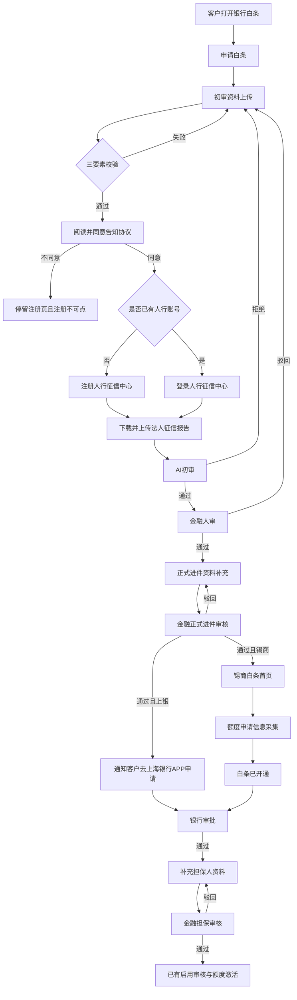

| 文档版本 | 日期 | 撰写人 | 修改描述 |
| --- | --- | --- | --- |
| V1.0 | 2026年09月21日 | 产品 | PRD 初稿：文档版本、背景和目标、受众、需求方案 |
| V1.1 | 2026年09月21日 | 产品 | 补全需求列表；补充客户端·银行白条首页需求明细 |
| V1.2 | 2026年09月21日 | 产品 | 补充客户端·初审资料上传需求明细 |
| V1.3 | 2026年09月21日 | 产品 | 初审资料上传底部增加【保存】，与提交按钮并列 |
| V1.4 | 2026年09月21日 | 产品 | 初审通过结果页增加业务员联系补充资料的提醒 |
| V1.5 | 2026年09月21日 | 产品 | 三要素失败弹层标题改为「白条申请失败提醒」 |
| V1.6 | 2026年09月22日 | 产品 | 补充业务端·白条申请需求明细 |
| V1.7 | 2026年09月22日 | 产品 | 补充业务端·客户档案白条档案需求明细 |
| V1.8 | 2026年09月22日 | 产品 | 补充 Admin·白条入口白名单；客户端入口受白名单与 48 小时可见期约束 |
| V1.9 | 2026年09月22日 | 产品 | 按页面布局顺序重写白名单需求明细：入口→筛选→列表→添加开通→开启确认 |
| V1.10 | 2026年09月22日 | 产品 | 添加开通增加开通时间：立即 / 选择日期；列表支持待生效 |
| V1.11 | 2026年09月22日 | 产品 | 按页面布局重写业务端·客户档案白条档案（不含未申请）；含查看详情 |
| V1.12 | 2026年09月22日 | 产品 | 白名单添加开通「选择日期」支持选择开始时分 |
| V1.13 | 2026年09月22日 | 产品 | 开启弹窗对齐添加开通（客户只读，可选开通时间） |

## 1. 背景和目标

### 1.1 背景

公司作为银行合作方，向养殖客户开放白条借款。当前申请仍依赖业务员线下收资料、群内转发流水和征信、金融人工核对邮箱是否收到，再分别在业务系统、银行侧和企微群之间同步结果。

主要痛点：

- 资料分散：营业执照、法人证件、征信、流水、经营证明、担保材料散落在客户、业务员和金融之间，缺件要反复催补。
- 校验滞后：三要素、人行征信是否收到、百行是否收到，缺少系统内即时校验，初审经常在资料不齐时才发现。
- 路径分叉多：额度档（小于 30 万 / ≥30 万）、养殖类型、是否牧场、主体类型、合作银行（上海银行 / 锡商银行）决定不同资料和后续动作，线下容易漏项或走错银行。
- 状态不透明：客户、业务员、金融审核看到的进度不一致，驳回原因和补件入口不在同一条工单上。

本次只覆盖「初审进件 → 正式进件与风控审核 → 推送银行 / 引导客户申请 → 银行通过后补担保人并审核」。启用审核、标签配置、额度激活为已有能力，不在本次开发范围。银行 APP 内申请页为外部系统，不在本次开发范围。

### 1.2 目标

- 客户可在银行白条入口完成初审资料提交、人行征信获取和正式进件补件，减少业务员代传基础证件。
- 客户端银行白条入口仅对白名单内且处于 48 小时可见期内的客户开放；超时隐藏，支持再次开启。
- 三要素、征信收取、流水收取在提交时完成系统校验，不齐不允许进入下一审核节点。
- 金融在同一审核台完成初审、正式进件、担保人资料审核，并按银行分叉推送锡商或通知上银申请。
- 业务员在白条申请和客户档案中查看进度、按驳回原因补件、填写正式申请资料和担保资料。
- 工单状态从初审到担保审核可追溯，结果同步到对应角色。

## 受众

| 角色 | 使用端 | 在本需求中要完成的事 |
| --- | --- | --- |
| 客户 | 客户端（银行白条） | 申请白条、上传初审与正式进件资料、完成人行征信授权与下载、查看审核结果；上银路径去银行 APP 申请；锡商路径完成额度申请信息采集 |
| 业务员 | 业务端 / 客户档案 | 查看申请进度与已交资料，发起或补充正式申请资料，银行通过后补充担保资料，按驳回原因重提 |
| 金融审核 | 金融审核台 | 初审、正式进件、担保人审核；查看 AI 结果与附件；通过 / 驳回；正式通过后按银行推送或通知 |
| 运营 / 配置人员 | Admin（粮巴巴管理系统） | 配置白条入口白名单：添加开通、开启、关闭；控制客户是否可见客户端银行白条入口 |
| 银行 | 外部 | 审批；锡商接收系统推送资料，上银由客户在银行 APP 申请。本需求不开发银行内部页面 |

## 2. 需求方案

### 2.1 功能流程图

步骤 4（启用审核、标签配置、额度激活）沿用已有流程，本图只接到入口，不展开。

### 2.2 需求列表

| 分类（产品模块） | 主要功能点 | 功能点拆分 | 优先级 |
| --- | --- | --- | --- |
| 客户端 · 银行白条首页 | 统一申请入口 | 仅白名单且 48 小时可见期内可进入 展示最高可借额度与产品卖点 【申请白条】进入初审资料上传 | P0 |
| Admin · 白条入口白名单 | 控制客户端入口可见 | 按客户添加开通，开启后 48 小时内可见入口 超时状态为已过期，入口隐藏；可【开启】重新起算 48 小时 可见中可【关闭】立即隐藏入口 列表筛选、操作人/操作时间 | P0 |
| 客户端 · 初审资料上传 | 提交初审并三要素校验 | 企业信息认证：营业执照、企业名称、统一社会信用代码 企业法人认证：身份证正反面、姓名、身份证号、实名手机号 信用分截图：支付宝芝麻分或微信支付分，二选一 实控人征信：已有征信上传（PDF/图片），或去人行征信中心获取 【保存】只存草稿；【提交】或【下一步，下载实控人征信报告】触发 e签宝三要素 | P0 |
| 客户端 · 人行征信获取 | 告知协议、注册或登录、下载法人征信 | 注册页弹出告知协议，倒计时结束才可同意；不同意则停留且【注册】不可点 同意后勾选协议并允许注册；已有账号走登录 申请并下载法人征信，展示上传成功 | P0 |
| 客户端 · 初审审核结果 | 展示 AI 与人审结果 | AI 审核中 / 拒绝（含原因，可修改资料）/ 通过进人审 人审通过展示「初审通过」，并提醒：初审已通过，后续业务员会联系您补充资料，进行额度评估 人审拒绝回初审修改 审核中：【返回】回银行白条首页（档案入口则回白条档案）；【查看提交资料】只读查看已提交初审资料，可【返回审核结果】 | P0 |
| 客户端 · 正式进件资料补充 | 按额度档提交经营资料 | 白条额度、养殖类型、是否牧场；≥30 万增加主体类型 必传资料随档位、养殖类型、牧场、企业主体变化 ≥30 万且法人非实控人时，在资料最后补充实控人信息与征信 流水邮箱未收到不可提交 | P0 |
| 客户端 · 正式进件结果与银行分流 | 查看审核结果并继续申请 | 审核中、驳回可修改资料 通过且上海银行：提示去上海银行 APP 申请 通过且锡商：进入锡商白条首页，再进入额度申请信息采集 白条已开通后进入担保人补充 | P0 |
| 客户端 · 担保人补充资料 | 客户侧补担保并查看审核 | 担保人证件、关系、资产证明、紧急联系人 审核中 / 通过 / 拒绝；拒绝可修改资料 | P0 |
| 业务端 · 白条申请 | 列表、进度、初审与正式入口 | 按客户查看工单状态、驳回原因、排队与时间轴 初审资料只读展示档案证件，校验征信/百行邮箱是否收到 正式申请按模板、额度档、养殖类型动态补资料 | P0 |
| 业务端 · 白条申请详情 | 查看单笔申请全貌 | 资料与 AI 结果、正式进件资料、业务员申请资料 平台客户信息、融资主体、初审附件、征信与交易信息、推送银行、操作日志 | P0 |
| 业务端 · 客户档案白条档案 | 档案内看白条并去补件 | 已申请：开通状态、银行、额度、四类资料齐全度 【去补齐】/【修改资料】/【去补充】跳转补件 底栏【查看详情】进申请详情全貌 | P0 |
| 业务端 · 申请资料填写 | 业务员提交正式申请材料 | 基础申请信息、预混料 / 全价料 / 大宗模板字段 附件资料包、CRM 拜访记录、尽调报告 | P0 |
| 业务端 · 担保资料填写 | 业务员补担保材料 | 实控人资料、资产证明、紧急联系人 养猪客户按加严代偿能力展示对应资料 | P0 |
| 金融端 · 白条审核台 | 初审、正式进件、担保审核 | 待办列表与状态筛选 初审详情：AI 结果、初审附件（含信用分、百行征信报告）、通过 / 驳回 正式进件：客户资料与业务员资料，通过后按银行推送或通知 担保审核：通过 / 驳回 | P0 |
| 消息通知 | 节点结果触达 | 初审结果、正式结果、上银引导、锡商已推送、银行通过、催补担保人、担保审核结果 接收人为业务员，上银通过同时通知客户 | P0 |
| 客户端 · 白条类型与百行 | 全价料客户补百行征信 | 是否全价料白条；选「是」后上传图片或校验邮箱是否收到 客户端原型本期隐藏该字段，规则保留，是否上线待确认 | P1 |
| 已有能力 | 启用办结 | 启用审核、标签配置、额度激活不新开发，担保审核通过后进入已有流程 | 不做 |

### 2.3 交互图

Admin · 白条入口白名单：粮巴巴管理系统 → 白条 → 白条入口白名单 →【添加开通】/【开启】/【关闭】；决定客户是否可见客户端银行白条入口。

银行白条首页：白名单可见期内打开银行白条 → 首页 → 【申请白条】→ 初审资料上传。不在名单或已过期则不可见入口。

初审资料上传：填写企业、法人、信用分和实控人征信 → 【提交】或【下一步，下载实控人征信报告】→ e签宝三要素通过 → 人行征信获取。三要素失败留在本页。

业务端 · 白条申请：列表筛选 → 点卡片进申请进度 → 按状态【补充正式进件资料】/【修改资料】/【申请白条】/【补充担保人资料】；或【+ 新建初审申请】进初审页提交。

业务端 · 客户档案白条档案：客户档案 → 白条档案 Tab（已申请）→ 看开通与资料齐全度 →【去补齐】/【修改资料】/【去补充】跳转补件；底栏【查看详情】进申请详情。

其余模块的用户路径随对应需求明细补齐。

## 3. 需求明细

### 3.1 客户端 · 银行白条首页

| 页面 | 逻辑 |
| --- | --- |
| **银行白条首页**  原型：`步骤1_客户初审三步流程_V3.html` 中「银行白条首页」；独立页 `客户端_银行白条.html` 跳入同一入口。  状态：未申请（本期仅此状态）  页面自上而下： 导航「银行白条」 口号「白条在手，买货不愁」 额度卡：最高可借额度 1,000,000 元；提示「10000元借1天，利息低至2.19元起」 卖点：随借随还、快速放款、安全可靠 【申请白条】 | **1. 入口** 客户从「我的资产」或银行白条菜单进入。默认落在本页，不直接进入填资料页。 **可见条件（与 Admin·白条入口白名单联动）**：仅当该客户在白名单中，且当前时间 &lt; 最近开通时间 + 48 小时时，客户端展示并允许进入银行白条入口。不在名单、已【关闭】、或已超过 48 小时：入口不可见（不展示菜单/入口位）。每次进入按服务端时间校验，不以本地缓存为准。  **2. 页面字段与规则** 最高可借额度、日息提示、三条卖点为产品展示文案，本期写死，不按客户资质计算。 未开通前不展示可用额度、借款余额、待还账单金额。 导航返回：有上一页则返回，否则留在本页。 分享：本期无业务动作。 本页不展示底栏（待还账单 / 使用记录 / 首页 / 还款记录 / 我的）。  **3. 操作与跳转** 【申请白条】：进入「初审资料上传」。客户尚未提交时看到空表单，不跳过资料填写，不直接进入三要素结果或征信页。  **4. 审批流程** 本页无审批。  **5. 消息通知** 本页不发消息。  **6. 边界与异常** 未登录不可进入；登录失效回到登录页。 无入口可见权限：不展示入口，不进入本页；深链直达时提示无权限或回到上一页。 已有在途申请时，仍从本页【申请白条】进入，由初审页按工单状态展示继续填写或当前结果，不在首页分支。 已开通客户的额度首页（锡商白条首页）不属于本页，见「正式进件结果与银行分流」。  **7. 数据字段** 本页不落库。点击【申请白条】只记录入口点击，用于统计申请转化。入口可见性读白名单：customer_id、opened_at、expire_at（或等价字段）。 |

### 3.2 客户端 · 初审资料上传

| 页面 | 逻辑 |
| --- | --- |
| **初审资料上传**  原型：`步骤1_客户初审三步流程_V3.html` 步骤 1 表单（`#chuShenFormBox`）。人行注册登录、征信下载、审核结果不在本页。  状态：未填写 / 识别后可改 / 已有征信上传 / 去人行获取 / 三要素校验中 / 三要素失败  页面自上而下： 导航「白条初审」，返回 步骤条：1 初审资料上传（当前）、2 正式进件资料补充、3 担保人补充资料 企业信息认证：营业执照正本（原件）、企业名称、统一社会信用代码 企业法人认证：身份证人像面、国徽面、法人姓名、法人身份证号、法人实名手机号 信用分：信用分截图，提示紧跟标题之后「支付宝芝麻分或者微信支付分，二选一」，不靠右对齐；【查看截图样例】 实控人征信报告：提交方式「已有征信上传 / 去人行征信中心获取」。上传时收 PDF 或图片；去人行时只提示将进入人行流程 页底提示「请上传清晰原件，勿多次提交错误信息」 底部两个按钮：左侧【保存】；右侧【提交】（含「已有征信上传」「去人行征信中心获取」两种方式）  白条类型、全价料、百行征信不展示。 | **1. 入口** 未申请或初审未提交完：从银行白条首页【申请白条】进入。无草稿为空表；有草稿带回已填内容和已传文件。 初审驳回：从审核结果【修改资料】回到本页，带回原资料，可改后再次提交。驳回原因留在审核结果页，本页不再重复一条原因。 初审审核中，以及初审已通过之后：不再打开本页编辑。首页【申请白条】进入当前结果或后续步骤。  **2. 页面字段与规则** 步骤条只展示进度，不能点进正式进件或担保。 营业执照、身份证人像面、身份证国徽面、信用分截图均为必传。上传营业执照后识别企业名称、统一社会信用代码；上传人像面后识别法人姓名、身份证号。识别成功提示「已识别，请核对，支持修改」。只回填仍为空的字段，不覆盖客户已改内容。识别失败不拦截，字段留空，提示手动填写。 企业名称、统一社会信用代码、法人姓名、法人身份证号必填，本页只校验非空，不校验证件号位数和校验位。 法人实名手机号必填，须为 1 开头的 11 位数字。提示「请输入该身份证对应的实名认证手机号」。三要素只用姓名、身份证号、该手机号。 信用分只做一个上传位，不设芝麻分 / 微信支付分选项，也不要求客户标明类型。【查看截图样例】打开样例层，含支付宝芝麻分、微信支付分两张参考图，【我知道了】或点遮罩关闭。 实控人征信提交方式必选，默认「已有征信上传」。选上传：展示上传位，支持 PDF、jpg、jpeg、png、webp、gif，其他格式提示「仅支持上传 PDF 或图片文件」并清空；已选文件展示文件名，可重选。选「去人行征信中心获取」：收起上传位并清空已选文件，展示「选择后将进入人行征信中心流程，下载并上传实控人征信报告」。 本页实控人征信始终展示，与额度无关。正式进件里「额度 ≥30 万且法人非实控人」的实控人信息是另一处，不在本页。 白条类型整块隐藏，本页不收集、不校验全价料和百行。该规则见需求列表 P1。  **3. 操作与跳转** 返回：回到银行白条首页。未提交内容保留。 【保存】：不校验必填，不调三要素，不离开本页。当前已填内容和已传文件记为草稿，提示「已保存」。再次进入带回。 两种方式都先校验本页，再调 e签宝。校验中【保存】和右侧按钮都不可点，右侧文案为「三要素校验中…」。 【提交】：两种征信方式共用。缺营业执照、身份证正反面、信用分时提示补齐；方式为已有征信上传时还须有实控人征信文件。企业或法人字段为空、手机号不合法，同样停留并提示。去人行方式不要求本页已有实控人征信文件。 三要素通过：实控人征信（若已上传）随初审资料保存，进入「人行征信获取」办理法人征信。本页不出审核结果，不视为初审已提交。去人行只决定本页是否收文件，不跳过法人征信。 三要素失败：弹层标题「白条申请失败提醒」，正文为「手机号不是实名手机号，请核对后修改再提交」。【我知道了】关闭弹层，留在本页，按钮恢复，已填内容保留。 从客户档案打开本页（地址带档案来源）时，底部固定为【提交初审资料】。三要素通过后提示已更新并返回档案，不进人行征信获取。  **4. 审批流程** 本页无审批。三要素只校验法人姓名、身份证号、实名手机号是否一致。  **5. 消息通知** 本页不发消息。业务员和金融的初审提交通知，在法人征信完成并进入审核后发送。  **6. 边界与异常** 未登录不可进入。 三要素接口失败或超时：留在本页，按钮恢复，提示稍后重试，不进人行征信。 校验进行中重复点击无效。 从「已有征信上传」改成「去人行征信中心获取」会丢掉本页已选文件，改回上传须重新选择。 同一客户同时只有一笔初审工单。审核中不能从本页再提交一笔。  **7. 数据字段** 保存：营业执照文件、企业名称、统一社会信用代码、身份证人像面、身份证国徽面、法人姓名、法人身份证号、法人实名手机号、信用分截图、实控人征信提交方式、实控人征信文件（仅上传方式）、三要素结果（通过 / 失败及原因）、三要素完成时间。 信用分不另存类型。全价料、百行本页不落库。 |

### 3.3 业务端 · 白条申请

原型：`业务端_白条申请.html`。本模块含列表、申请进度、初审进件、正式进件四个页面。补充担保人资料的入口在进度页，填写明细见「业务端 · 担保资料填写」。更完整的单笔全貌见「业务端 · 白条申请详情」。

| 页面 | 逻辑 |
| --- | --- |
| **白条申请列表**  导航「金融白条申请」  顶部分组：全部 / 进行中 / 已驳回 / 已办结  卡片：客户名、状态标签、摘要信息；驳回时展示驳回原因；有待办时展示操作按钮  底部【+ 新建初审申请】 | **1. 入口** 业务端菜单「金融白条申请」或同等入口。只展示当前业务员名下客户工单。  **2. 页面字段与规则** 分组与状态对应：进行中含初审审核中、初审通过、正式进件审核中、进件资料审核通过、银行审核中、银行审核通过、待开启配置等；已驳回含初审已驳回、进件资料被驳回 / 正式已驳回；已办结含已办结、禁用。 卡片摘要随状态变化：提交时间、申请人、排队人数（审核中）、初审/正式通过时间、合作银行与额度、银行/启用相关说明等。 驳回卡片在摘要下展示「驳回原因：…」。 空态：暂无申请。  **3. 操作与跳转** 点卡片：进入「申请进度」（本模块内进度页）。 卡片上按钮不冒泡进进度，直接进对应页：【补充正式进件资料】/【重新补充进件资料】→ 正式进件；【修改资料】→ 初审进件（修改）；【申请白条】→ 上银提示去银行 APP，锡商提示已推送等待银行；【补充担保人资料】→ 担保资料填写。 【+ 新建初审申请】→ 初审进件（新建）。同一客户已有在途工单时不可再新建，提示已有申请。  **4. 审批流程** 本页无审批。  **5. 消息通知** 本页不发消息；业务员从消息卡片可跳回本列表或进度。  **6. 边界与异常** 未登录不可进入。列表只读自己客户；无权限客户不展示。  **7. 数据字段** 读：工单 id、客户名、状态、分组、提交/通过时间、合作银行、额度、产品模板、申请人、排队人数、驳回原因、可用操作。 |
| **申请进度**  导航「申请详情」；返回回列表  卡片：客户名、状态、摘要、排队（审核中）、驳回原因、操作按钮  申请进度时间轴  已提交资料：关键信息 + 资料清单与收取状态 | **1. 入口** 列表点卡片进入。  **2. 页面字段与规则** 状态与摘要规则同列表。审核中（初审或正式）展示「前面还有 N 位客户排队审核中」。 时间轴按工单节点展示已完成 / 当前 / 未开始（如提交初审、金融初审、正式进件、银行审批、补担保人/启用等），文案随状态变化。 关键信息：提交时间、实名手机号、征信银行、是否全价料白条、合作银行、申请额度、产品模板；无值显示 —。 资料清单：项名称 + 状态（系统带入 / 邮箱已收到 / 未收到 / 已提交 / 已归档 / 已驳回 / 待补充等）。  **3. 操作与跳转** 返回：回列表。 操作按钮与列表同状态规则，跳转同列表。 进件资料审核通过且上银：【申请白条】提示引导客户上银 APP，并视为已发客户引导（与消息通知一致）。锡商：提示资料已推送、等待银行，不打开外部页。 本页不编辑资料正文；改资料走初审/正式页。  **4. 审批流程** 只读进度，无审批。  **5. 消息通知** 本页不发。  **6. 边界与异常** 工单不存在或无权限：提示并回列表。  **7. 数据字段** 读：同上 + 时间轴节点、资料清单项与状态。 |
| **初审进件 / 修改资料**  导航新建为「初审进件」，驳回重提为「修改资料」  客户名称 营业执照、法人身份证正反面（客户档案只读） 实名手机号 个人征信：征信银行、【检查是否已收到】 是否全价料白条；选「是」展示百行【检查是否发送成功】 备注（选填） 底部【提交初审】或【提交修改】 | **1. 入口** 【+ 新建初审申请】；或初审已驳回【修改资料】。客户已在客户端提交的初审，业务员以进度查看为主；业务员代提仍走本页。  **2. 页面字段与规则** 客户名称必填，关联 CRM 客户。营业执照、法人身份证正反面从客户档案带出，只读，不在本页重传。 实名手机号必填，放在身份证照片之后。 征信银行必选。个人征信不在本页上传文件，须客户/业务在银行 APP 直发金融邮箱；【检查是否已收到】查收取状态。未收到不可提交。 是否全价料白条必填，默认否。选「是」须百行邮箱校验通过后才可提交；选「否」不展示百行。 备注选填。 修改资料：带回原填写与校验结果，可改后重提。  **3. 操作与跳转** 【检查是否已收到】/【检查是否发送成功】：即时查邮箱，通过提示已收到；未收到提示未收到并停留。 【提交初审】/【提交修改】：校验客户、手机号、征信银行、征信已收到；全价料时百行已收到。通过后工单变「初审审核中」，触发风控查询，进入金融初审待办；返回列表/进度。 返回：回上一页，未提交不保存为已提交工单（草稿策略与现网一致即可）。  **4. 审批流程** 提交后进入金融初审，本页不审。  **5. 消息通知** 提交成功后通知金融有新初审待办（细则见消息通知模块）。结果通知在审核完成后发业务员。  **6. 边界与异常** 档案缺营业执照或身份证：不可提交，提示先补客户档案。 邮箱校验接口失败：可重试，不视为已收到。  **7. 数据字段** 客户 id/名称、实名手机号、征信银行、征信收取状态与时间、是否全价料、百行收取状态与时间、备注、提交人、提交时间。证件文件引用档案，不在本页另存。 |
| **正式进件 / 重新补充进件资料**  导航「正式进件」或「重新补充进件资料」  客户（只读） 申请模板；上银/锡商额度与产品类型；申请总额度（自动汇总）与档位提示 不申请上银时原因；申请原因；养殖种类与规模 模板结构化字段；公共附件；额度档动态附件；专项政策块 底部【提交正式进件】或【重新提交正式进件】 | **1. 入口** 初审通过或正式驳回后，从列表/进度【补充正式进件资料】或【重新补充进件资料】进入。客户侧正式补件与业务员正式进件并行时，以工单汇总为准，业务员本页提交的是业务侧正式申请资料。  **2. 页面字段与规则** 客户只读。申请模板必选：预混料 / 全价料 / 大宗 / 青年鸡 / 水产等（与原型选项一致）。 上银额度、锡商额度（万）必填；全价料模板隐藏锡商额度与锡商产品类型，总额=上银额度；其他模板总额=上银+锡商。 总额 ≥30 万：档位提示加严资料；30–50 万提示保证金至少 5%，≥50 万至少 10%。＜30 万按低档资料。 上银/锡商产品类型必选；上银选「不申请上银」时须填不申请原因，并按规则处理锡商侧填写。 申请原因、养殖种类、养殖规模必填；规模占位随种类（羽/头/只/亩等）。 模板结构化信息随模板切换（如合作次数、免息天数、绑定预混料、全价料厂家等），必填项随模板。 公共附件独立上传，不合并为一包：银行流水、经营许可证、个人/企业资产证明、其他银行要求材料等。 动态附件按＜30 万 / ≥30 万切换（流水邮箱说明、现场照/视频、水电、买卖合同或首付、防疫、牧场乳企合同、场地权属、三表、实控人征信/百行等，与 MRD 清单一致）。专项（水产/青年鸡/养猪等）展示规则说明与对应上传位。 重新补充：带回上次内容与驳回项，可改后重提。  **3. 操作与跳转** 改模板、额度、养殖种类：即时重算总额、档位提示与资料清单。 【提交正式进件】/【重新提交正式进件】：校验必填与必传；流水等须邮箱已收到的，未收到不可提交。通过后状态为「正式进件审核中」，进入金融正式审核；返回进度/列表。  **4. 审批流程** 提交后金融正式审核；通过后按银行分叉（锡商推送 / 上银通知客户申请），本页不审。  **5. 消息通知** 提交后通知金融待办。审核结果见消息通知模块。  **6. 边界与异常** 初审未通过不可进本页。全价料与预混料/大宗字段差异以模板为准，避免混填。  **7. 数据字段** 模板、上银/锡商额度与产品类型、总额、不申请上银原因、申请原因、养殖种类与规模、模板扩展字段、各附件文件与邮箱校验状态、提交人、提交时间。 |

### 3.4 业务端 · 客户档案白条档案

原型：`业务端_客户档案_白条档案.html`。挂在客户档案「白条档案」Tab。本期只写**已申请**场景（资料齐全 / 资料缺失 / 驳回）及【查看详情】；未申请白条不在本期范围。

本模块按页面布局自上而下书写：入口与导航 → 白条档案摘要卡 → 资料行操作 → 底栏查看详情 → 查看详情页各区块。

| 页面 | 逻辑 |
| --- | --- |
| **客户档案 · 白条档案（已申请）**  演示态：已申请·资料齐全 / 已申请·资料缺失 / 已申请·驳回  导航「客户档案」；返回 ‹ 横向 Tab：机会点、交易配置、地址管理、银行资质、白条档案（当前）  卡片「白条档案」自上而下： 客户姓名 平台审核状态 驳回原因（仅驳回时展示） 白条银行 白条额度 可用额度 初审资料 · 齐全度 + 右侧按钮 正式进件资料 · 齐全度 + 右侧按钮 业务员申请资料 · 齐全度 + 右侧按钮 担保资料 · 齐全度 + 右侧按钮  底栏【查看详情】 | **1. 入口与导航** 业务端打开某客户「客户档案」，切到「白条档案」。本需求只做该 Tab；机会点、交易配置、地址管理、银行资质为已有或示意，不在本期改。 返回：回客户档案上一页或客户列表（现网返回逻辑）。无该客户权限不可进。  **2. 状态与摘要字段** 本页仅覆盖已申请。开通状态随工单展示，字色：通过类绿（如白条已开通）、进行中橙（如正式进件审核中）、驳回类红（如初审驳回）。示例： · 资料齐全：白条已开通；银行上海银行；额度 50 万；可用 32 万；四类资料均为「齐全」。 · 资料缺失：正式进件审核中；银行可多行（如上银、锡商）；可用额度可为 —；部分资料「缺失 N 项」。 · 驳回：初审驳回；银行/额度/可用可为 —；展示驳回原因；后续阶段资料可为 —。 驳回原因：仅驳回类状态展示整行；无驳回则隐藏该行。 白条银行、白条额度、可用额度：有值展示，无值 —。  **3. 资料行** 四类齐全度取值：齐全 / 缺失 N 项（N≥1）/ —（该阶段尚未开始）。字色：齐全绿、缺失红、— 默认。 右侧按钮随齐全度： · 缺失… →【去补齐】 · 齐全 →【修改资料】 · — →【去补充】 跳转（带档案来源，便于返回本 Tab）： · 初审资料 → 客户端初审资料上传 · 正式进件资料 → 客户端正式进件资料补充 · 业务员申请资料 → 业务端·申请资料填写 · 担保资料 → 客户端担保人补充资料  **4. 底栏** 已申请时展示【查看详情】，进入「查看详情」页（见下行）。本页无审批、不发消息。补件提交成功后回本 Tab，刷新齐全度与开通状态。  **5. 数据字段** 读：客户姓名、开通状态、驳回原因、白条银行、白条额度、可用额度、初审/正式进件/业务员申请/担保四类齐全度、当前工单 id。本页不落库。 |
| **查看详情**  入口：白条档案底栏【查看详情】（或演示「查看详情」） 导航标题「查看 · {客户姓名}」；返回回白条档案 Tab  自上而下卡片： ① 资料与 AI 识别 ② 平台客户信息 ③ 融资主体信息 ④ 初审附件 ⑤ 客户正式进件资料（未提交时空提示） ⑥ 业务员申请资料（未提交时空提示） ⑦ 征信信息 ⑧ 交易信息 ⑨ 推送银行 ⑩ 操作日志 | **1. 入口** 仅已申请可进。返回关闭详情，回到白条档案 Tab。  **2. 资料与 AI 识别** 展示块：初审资料齐全度；非纯初审阶段时增加客户正式进件资料、业务员申请资料齐全度；AI 审核结果和建议（含说明文案、门槛提示）。驳回时增加「驳回原因」红底块。  **3. 平台客户信息** 手机号、客户姓名、业务员、平台审核状态（如白条已开通 / 正式进件审核中 / 初审驳回）。  **4. 融资主体信息** 融资主体名称、法人手机号、全价料白条（是/否）、进件门槛提示文案。  **5. 初审附件** 网格：营业执照、法人身份证正面、法人身份证反面、法人征信报告；已上传高亮，未上传为占位。  **6. 客户正式进件资料** 有数据时：状态；额度档位、产品类型、是否全价料白条；经营性流水来源、流水解压密码；附件网格（邮箱解析流水 / 百行 / 实控人征信 + 上传类附件）。 无数据：初审未通过提示「初审通过后方可补充正式进件资料」；否则「暂未提交正式进件资料」。  **7. 业务员申请资料** 有数据时：状态；白条产品类型、额度档位、上银/锡商额度、养殖种类与数量、申请原因；现场照片；CRM 拜访记录。 无数据：「暂未提交业务员申请资料」。  **8. 征信信息** 逾期笔数、不良贷款笔数、已结清贷款笔数。  **9. 交易信息** 近 6 月累计交易月数、月均交易吨数、月均交易金额（元）。  **10. 推送银行** 上海银行、锡商银行：额度金额、推送状态标签、审批结果标签。  **11. 操作日志** 时间轴节点（已完成 / 当前）；无记录时「暂无操作记录」。  **12. 边界** 只读全貌，本页不编辑、无审批、不发消息。字段随工单阶段有无展示正式进件/业务员块。 |

### 3.5 Admin · 白条入口白名单

原型：`Admin_白条入口白名单.html`。对齐 Admin 设计规范 V3.0。控制客户端「银行白条」入口是否可见：白名单内且 48 小时可见期内可见，超时隐藏，支持再次开启。

本模块按页面布局自上而下书写：入口 → 规则说明 → 筛选 → 列表 → 添加开通弹窗 → 开启弹窗。

| 页面 | 逻辑 |
| --- | --- |
| **白条入口白名单 · 列表**  状态：有数据 / 空态  壳层：顶栏 + 侧栏；一级「白条」下「白条入口白名单」；内容区页签「白条入口白名单」  页内自上而下： ① 标题「白条入口白名单」 ② 规则说明条 ③ 筛选区：客户名称、状态；【搜索】【重置】 ④ 工具栏【添加开通】 ⑤ 数据表 + 分页  空态：文案「暂无白名单客户」+【添加开通】 | **1. 入口** 粮巴巴管理系统 → 白条 → 白条入口白名单（本期新增；侧栏挂载位置待确认）。仅配置权限角色可进；未登录或无权限不可进。  **2. 规则说明** 页顶固定展示：开启后，客户在 48 小时内可在客户端看到银行白条入口；超时后入口隐藏。已过期客户可【开启】，重新获得 48 小时可见入口。不在名单中的客户始终不可见入口。 计时：可见截止 = 最近开通时间 + 48 小时；时区按服务器时间。若开通时间选未来开始时刻，到达该时分后才进入可见期。客户端每次进入按服务端时间校验，不以本地缓存为准。  **3. 筛选** 客户名称：输入框，支持按客户名称或手机号模糊搜（列表不展示手机号列）。 状态：全部 / 可见中 / 待生效 / 已过期。 【搜索】：按条件过滤，回到第 1 页。 【重置】：清空条件，状态回「全部」，刷新列表第 1 页。  **4. 工具栏** 【添加开通】：打开「添加开通」弹窗（见下行）。空态下同入口。  **5. 列表** 列：客户名称、客户 ID、最近开通时间、可见截止时间、状态、操作人、操作时间、操作。 状态列： · 待生效：开通时间未到；展示「将于 YYYY-MM-DD HH:mm:ss 生效」；操作仅【关闭】。 · 可见中：标签「可见中」；操作仅【关闭】。 · 已过期：标签「已过期」；操作仅【开启】。 操作人 / 操作时间：最近一次添加开通或开启的操作者与时间。 【关闭】：可见中、待生效。点击后弹出「关闭确认」，文案「确认关闭白条入口的可见权限？」【取消】【确认关闭】。确认后从名单移除，入口立即不可见。 【开启】：仅已过期。打开「开启」弹窗（见下行）。 分页：展示总条数、页码、每页条数（默认 10）。  **6. 空态** 无任何白名单记录时展示空态与【添加开通】；有数据但筛选无结果时展示空表/无数据提示（保留筛选条件）。  **7. 审批 / 消息 / 数据** 无审批；开启/关闭即时生效；本期不做批量开通、不做消息通知。 字段：customer_id、customer_name、mobile（检索用，列表不展示）、opened_at、expire_at（或 opened_at+48h）、operator、operated_at、updated_at。 |
| **添加开通弹窗**  标题「添加开通」；关闭 ×  表单项自上而下： 选择客户（必填，搜索名称 / ID / 手机号下拉选） 开通时间（必填）：单选「立即」/「选择日期」；选日期时展示开始时间控件（日期 + 时分） 提示：立即 →「开通后立即生效，客户将在 48 小时内可见银行白条入口。」；选日期 →「到达所选开始时间起生效，起算 48 小时可见入口（须选择日期与时分）。」 底栏【取消】【保存】 | **1. 入口** 列表或空态点【添加开通】打开；点遮罩或 × /【取消】关闭，回列表。  **2. 字段与规则** 选择客户必填；从客户主数据检索，支持名称、客户 ID、手机号。 开通时间必填，默认「立即」。 · 立即：最近开通时间=当前时刻，状态为可见中。 · 选择日期：须选择开始时间（含日期与时分，精确到分）；最近开通时间=所选开始时间；若晚于当前则为待生效，到达后自动变为可见中。 可见截止=最近开通时间+48 小时。写入操作人、操作时间（操作时间为保存时刻）。  **3. 操作** 【保存】：未选客户提示请选择客户；选日期未选开始时间提示请选择开通开始时间（含时分）。已在名单且可见中：提示已在有效期内，不重复开通。已过期或待生效同一客户：更新开通时间，不开新行。【取消】关闭不保存。  **4. 边界** 客户不存在或已停用不可选。无审批、无消息。 |
| **开启弹窗**  标题「开启」；关闭 ×  表单项自上而下（与添加开通同布局）： 客户（只读，不可改） 开通时间（必填）：单选「立即」/「选择日期」；选日期时展示开始时间控件（日期 + 时分） 提示：立即 →「开启后立即生效，重新起算 48 小时可见入口。」；选日期 →「到达所选开始时间起生效，起算 48 小时可见入口（须选择日期与时分）。」 底栏【取消】【保存】 | **1. 入口** 列表已过期行点【开启】打开；遮罩、×、【取消】关闭回列表。  **2. 字段与规则** 客户只读展示当前行（名称 / 手机号 / id），不可搜索更换。 开通时间规则与「添加开通」相同：立即则当前时刻生效并起算 48 小时；选择日期须含时分，可为待生效。 保存后：更新最近开通时间与可见截止；更新操作人、操作时间。  **3. 操作** 【保存】：选日期未选开始时间提示请选择开通开始时间（含时分）。【取消】不改数据。  **4. 边界** 确认时记录已不存在（已被关闭等）：提示记录不存在，关弹窗并刷新列表。无审批、无消息。 |
