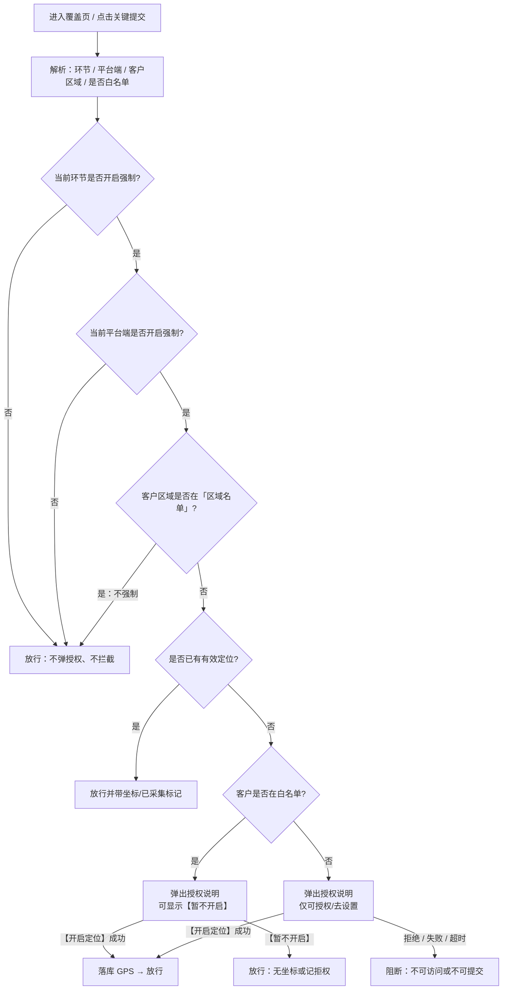
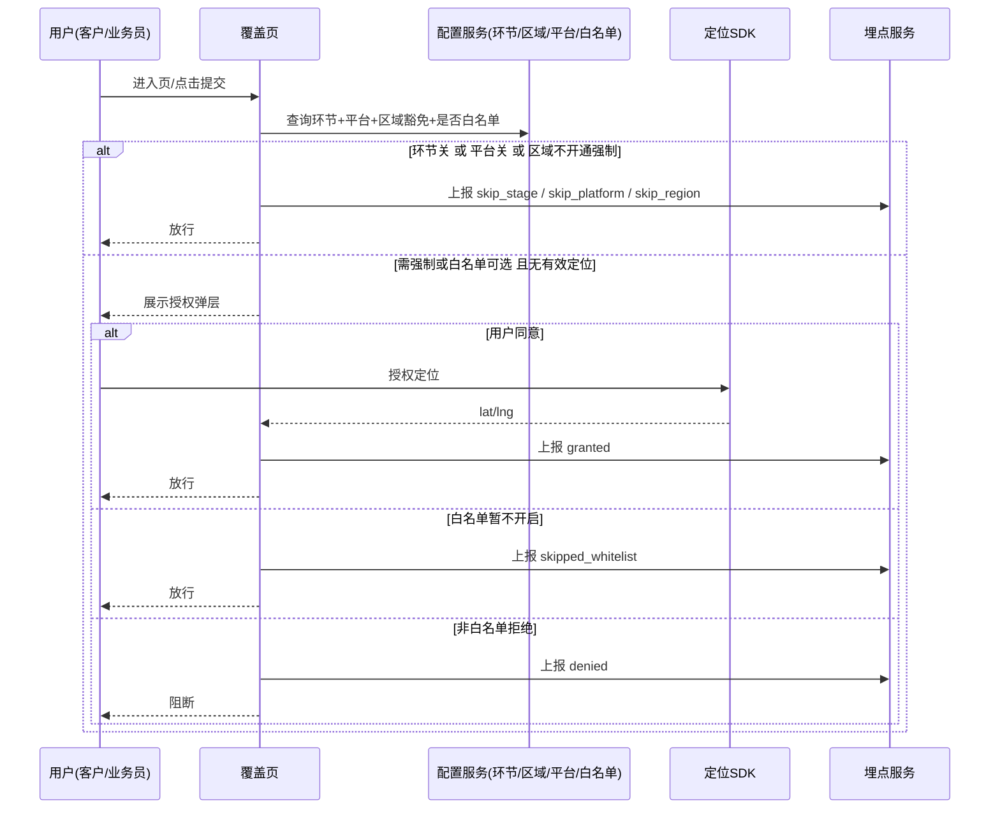

# 【需求】GPS定位授权（风控埋点）

| 文档版本 | 日期 | 撰写人 | 修改描述 |
| ---- | ----------- | --- | ------ |
| V1.0 | 2026年09月11日 | — | 按标准 PRD 模版重写初稿 |
| V1.1 | 2026年09月11日 | — | 对齐 `prd模版.md` 固定结构 |
| V1.3 | 2026年09月14日 | — | 按区域改为名单制（同客户白名单）：配置=不强制，未配置=强制 |

**关联**：`gps.md`  
**原型**：
- 客户端 / 业务端：`客户端业务端_定位授权.html`
- 管理端：`Admin_定位开关与白名单.html`

---

## 1. 背景和目标

### 1.1 背景

- 客户在注册、下单、提货、收银台及合同/提货单等关键节点访问时，缺少统一的位置授权与 GPS 采集，风控难以拿到真实坐标。
- 业务代下单、代提货及合同/提货单浏览同样存在坐标缺失，事后补录成本高、可信度低。
- 强制采集不能一刀切：试点区域、部分端、部分环节、特批客户需要可独立关闭或豁免，避免误拦业务。

### 1.2 目标

- 在约定覆盖页统一接入定位授权，保证关键节点可落库经纬度（或明确「拒权 / 本维度未强制」结果）。
- 按**环节、区域、平台端、客户**四维配置是否强制 GPS；**取消全局单一开关**作为主控。
- 仅当四维同时命中强制条件时拦截未授权；白名单客户可拒权后继续操作。
- 客户侧与业务代操作侧规则一致；业务侧白名单与区域按「被操作客户」判定，采集操作人（业务员）端 GPS。

### 1.3 受众

| 角色 | 说明 |
| ---- | ---- |
| 客户（C 端） | 注册、下单、提货、支付、合同/提货单浏览 |
| 业务员 | 代下单、代提货、合同/提货单列表与详情 |
| 风控 / 运营 | 配置环节 / 区域 / 平台强制策略、维护客户白名单 |
| 研发 / 测试 | 实现与验收门禁、埋点、Admin |

### 1.4 名词释义

| 名词 | 说明 |
| ---- | ---- |
| 有效定位 | 本会话或近 N 分钟内（建议 30 分钟，可配置）已成功获取经纬度 |
| 环节 | 注册、下单、提货、付款；各环节开关**彼此独立**，关闭只影响本环节 |
| 区域名单 | 已加入名单的区域 = **不强制** GPS（可不授权，也可自愿授权）；**未加入**名单的区域走强制授权 |
| 平台端 | PC、WAP、APP；关闭后该端所有环节均不强制 |
| 白名单 | 四维已命中强制时，仍可拒绝授权并继续使用系统的客户集合 |
| 覆盖页 | 本期纳入定位门禁的页面清单（见 2.2），并归属到某一环节 |
| 强制 GPS | 必须授权成功才可访问/提交；拒绝则阻断 |

---

## 2. 需求方案

### 2.1 功能流程图

**强制判定（须同时为真才强制）**

1. 当前**环节**开关 = 开  
2. 当前**平台端**开关 = 开  
3. 客户所属**区域未在**「区域名单」中  
4. 客户**不在**白名单  

任一不满足则不强制。其中 1～3 不满足：**不弹授权、不拦截**（区域名单内客户也可自愿授权）；仅 4 不满足（白名单）：**弹出可选授权**，可「暂不开启」后继续。

各环节独立：例如注册关闭，只表示注册页不强制；下单若开启且平台/区域命中，下单仍可强制。区域只添加甘宁 → 仅甘宁不强制。



**决策矩阵**

| 环节 | 平台 | 区域不开通强制 | 白名单 | 用户行为 | 结果 |
| ---- | ---- | ---- | ---- | ---- | ---- |
| 关 | — | — | — | 任意 | **该环节**不弹、不拦 |
| 开 | 关 | — | — | 任意 | **该端**不弹、不拦 |
| 开 | 开 | 是 | — | 任意 | **该区域客户**不弹、不拦 |
| 开 | 开 | 否 | 是 | 同意授权 | 记录 GPS，正常访问/操作 |
| 开 | 开 | 否 | 是 | 拒绝授权 | **允许**继续；可不落经纬度或记「拒权」 |
| 开 | 开 | 否 | 否 | 同意授权 | 记录 GPS，正常访问/操作 |
| 开 | 开 | 否 | 否 | 拒绝/权限关/超时 | **阻断**访问或关键提交 |

**独立性说明**：注册关 + 下单开 + APP 开 + 客户在华东（未勾选不开通）+ 非白名单 → 注册不强制，下单强制。区域仅勾选甘宁 → 仅甘宁客户全环节不强制，晋陕/黑吉等仍可强制。

### 2.2 需求列表

| 分类（产品模块） | 主要功能点 | 功能点拆分 | 优先级 |
| -------- | ----- | --------- | -------- |
| 定位授权组件（客户/业务共用） | 进入页门禁 | 读环节/平台/区域/白名单、有效定位缓存、遮罩拦截 | P0 |
| 定位授权组件（客户/业务共用） | 关键动作二次校验 | 注册/下单/提货/支付提交前再校验 | P0 |
| 定位授权组件（客户/业务共用） | 授权弹窗 | 【开启定位】【暂不开启】（仅白名单）【去系统设置】 | P0 |
| 定位授权组件（客户/业务共用） | GPS 埋点上报 | lat/lng、精度、页面、动作、未强制原因、操作人角色等 | P0 |
| 客户侧覆盖页 | 注册/下单/申请提货/收银台 | 进入 + 提交门禁；分别归属注册/下单/提货/付款环节 | P0 |
| 客户侧覆盖页 | 合同列表/详情、提货单列表/详情 | 进入门禁；合同归属下单，提货单归属提货 | P0 |
| 业务侧覆盖页 | 代下单、代提货 | 同客户规则；采集业务员端 GPS；区域/白名单看客户 | P0 |
| 业务侧覆盖页 | 合同/提货单列表与详情 | 进入门禁 | P0 |
| Admin 配置 | 按环节强制开关 | 注册 / 下单 / 提货 / 付款各自启停；最近修改人/时间、操作日志 | P0 |
| Admin 配置 | 按区域名单 | 列表添加/移除区域；**在名单内 = 不强制**；未配置 = 强制；样式同客户白名单 | P0 |
| Admin 配置 | 按平台端强制开关 | PC / WAP / APP 各自启停 | P0 |
| Admin 配置 | 客户白名单 | 搜索添加、列表、移除；短时生效（≤1 分钟） | P0 |

**环节 ↔ 覆盖页（本期约定）**

| 环节 | 覆盖页 |
| ---- | ---- |
| 注册 | 客户注册页 |
| 下单 | 下单页、业务代下单；合同列表/详情（签约关联） |
| 提货 | 申请提货、提货单列表/详情、业务代提货 |
| 付款 | 收银台 / 发起支付 |

**区域枚举（与现网业务区域对齐，可扩展）**：甘宁、晋陕、黑吉、蒙西、华北、华东。配置交互对齐客户白名单：搜索选择后加入名单；**在名单内 = 不强制（可不授权，可自愿授权）**；未配置区域走强制。例：只添加甘宁 → 仅甘宁不强制。

**平台端**：PC（管理后台 / PC 站点，含业务端代操作）、WAP（手机浏览器 H5）、APP（原生 / 内嵌 App）。某端关闭后，该端所有环节均不强制。

### 2.3 交互图

**客户 / 业务员路径**

```text
打开覆盖页
  → 解析当前环节、当前端、客户区域、是否白名单
  →（环节关 或 平台关 或 区域不开通强制）直接进页
  →（四维可强制 + 已有定位）直接进页
  →（环节开 + 平台开 + 区域需强制 + 无定位）授权弹层
        →【开启定位】成功 → 进页/可提交
        →【暂不开启】（仅白名单）→ 进页/可提交
        → 拒绝（非白名单）→ 页面锁定，不可操作
点击【提交注册/下单/提货/支付】
  → 再次按当前环节校验（规则同上）
```

**运营配置路径**

```text
Admin 定位授权配置
  →【按环节】切换注册/下单/提货/付款 → 仅影响对应覆盖页
  →【按区域】勾选「不开通强制」→ 仅影响该区域客户
  →【按平台端】切换 PC/WAP/APP → 仅影响该端
  →【按客户】添加/移除白名单 → 影响该客户是否可拒权继续
```



---

## 3. 需求明细

| 页面 | 逻辑 |
| --------- | ------------- |
| **定位授权弹层（共用组件）**<br/><br/>原型：`客户端业务端_定位授权.html`<br/><br/>状态：<br/>1）非白名单拦截态（无【暂不开启】）<br/>2）白名单可拒态（有【暂不开启】）<br/>3）授权成功（展示坐标摘要后关闭） | **1. 入口**<br/>覆盖页进入时、或关键提交前：环节开 ∧ 平台开 ∧ 区域需强制 ∧ 无有效定位时拉起。<br/><br/>**2. 页面字段与规则**<br/>- 标题：需要开启位置权限<br/>- 说明文案：<br/>　· 非白名单：为保障交易安全，需开启位置权限后才能继续…<br/>　· 白名单：建议开启…您在白名单内，可选择「暂不开启」继续<br/>- 【暂不开启】仅白名单可见<br/><br/>**3. 操作与跳转**<br/>- 【开启定位】：调起系统定位；成功则落库并关闭弹层放行；失败提示可重试 / 【去系统设置】<br/>- 【暂不开启】：关闭弹层并放行（记拒权）<br/><br/>**4. 审批流程**<br/>无<br/><br/>**5. 消息通知**<br/>无<br/><br/>**6. 边界与异常**<br/>- 定位超时（建议 8–15s）按失败<br/>- 系统权限永久拒绝：引导去设置；非白名单保持阻断<br/>- 环节/平台/区域任一导致不强制：不进入本弹层<br/><br/>**7. 数据字段**<br/>见第 5 章埋点 |
| **客户侧 · 注册 / 下单 / 申请提货 / 收银台**<br/><br/>原型同文件内页面切换 | **1. 入口**<br/>原有业务入口不变；叠加定位门禁。<br/><br/>**2. 页面字段与规则**<br/>- 业务字段沿用现网<br/>- 定位状态：已授权 / 白名单拒权 / 本环节未强制 / 本端未强制 / 区域不开通强制<br/>- 拦截时机：进入页 + 【提交注册】【提交订单】【提交提货申请】【立即支付】前<br/>- 环节归属：注册→注册；下单→下单；申请提货→提货；收银台→付款<br/><br/>**3. 操作与跳转**<br/>- 强制命中且无有效定位：按钮不可用或点击拉起授权<br/>- 有定位、白名单已拒权、或环节/平台/区域不强制：按原流程提交<br/><br/>**4. 审批流程**<br/>无（本需求不改业务审批）<br/><br/>**5. 消息通知**<br/>无<br/><br/>**6. 边界与异常**<br/>- 提交瞬间定位失效：再次拉起授权（仍须满足强制四维）<br/>- 跨环节：注册未授权不影响「下单环节关闭」时的下单页；下单环节开启则下单仍走门禁<br/><br/>**7. 数据字段**<br/>page_code：`register` / `order` / `pickup` / `cashier`；stage：`register` / `order` / `pickup` / `pay`；action：`enter` / `submit` / `pay` |
| **客户侧 · 合同列表/详情、提货单列表/详情** | **1. 入口**<br/>列表、详情原有入口。<br/><br/>**2. 页面字段与规则**<br/>- 进入即校验；无提交类二次校验（除非页内另有关键按钮，同门禁）<br/>- 合同列表/详情归属**下单**环节；提货单列表/详情归属**提货**环节<br/><br/>**3. 操作与跳转**<br/>- 强制命中未授权：列表/详情锁定，不可点进详情或不可浏览<br/>- 白名单可【暂不开启】后正常浏览<br/>- 对应环节关闭或平台/区域不强制：直接浏览<br/><br/>**4～5**<br/>无<br/><br/>**6. 边界与异常**<br/>从列表进详情若会话定位仍有效可不再弹<br/><br/>**7. 数据字段**<br/>page_code：`contract_list` / `contract_detail` / `pickup_list` / `pickup_detail` |
| **业务侧 · 代下单 / 代提货 / 合同与提货单** | **1. 入口**<br/>CRM/业务端原有代操作入口（平台端一般记为 PC，以实际上报端为准）。<br/><br/>**2. 页面字段与规则**<br/>- **规则同客户侧**（同一套环节/平台/区域/白名单判定）<br/>- 区域、白名单：按**被代操作客户**判定<br/>- 坐标：采集**业务员操作端** GPS<br/>- operator_role = `salesman`<br/><br/>**3. 操作与跳转**<br/>同客户侧门禁与【提交】校验<br/><br/>**4～5**<br/>无<br/><br/>**6. 边界与异常**<br/>业务员本人不在白名单、不属客户区域，均不影响；只看被操作客户<br/><br/>**7. 数据字段**<br/>customer_id=被操作客户；operator_id=业务员；platform=实际上报端 |
| **Admin · 定位授权配置**<br/><br/>原型：`Admin_定位开关与白名单.html`<br/><br/>状态：四个 Tab（环节 / 区域 / 平台端 / 客户）；白名单空态/有数据 | **1. 入口**<br/>风控/运营后台 · 定位授权配置。<br/><br/>**2. 页面字段与规则**<br/>页顶只读说明：强制 = 环节开 ∧ 平台开 ∧ 区域未勾选不开通 ∧ 非白名单。<br/><br/>**Tab 按环节**<br/>- 注册、下单、提货、付款各一行开关「强制获取 GPS」<br/>- 关 = **仅该环节**不触发强制；与其他环节无关<br/>- 展示覆盖说明（见 2.2 映射）及最近修改人、时间<br/><br/>**Tab 按区域**<br/>- 交互对齐客户白名单：搜索选择区域 → 加入名单 / 移除<br/>- **在名单内** = 不强制（可不授权，可自愿授权）<br/>- **未配置** = 走强制授权<br/>- 例：只添加甘宁 → 仅甘宁不强制<br/><br/>**Tab 按平台端**<br/>- PC、WAP、APP 各一开关「强制获取 GPS」<br/>- 关 = 该端全环节不强制<br/><br/>**Tab 按客户（白名单）**<br/>- 客户名称、客户ID、角色、手机号、所属区域、添加人、添加时间<br/>- 支持名称/手机/ID 搜索<br/><br/>**3. 操作与跳转**<br/>- 切换任一维度开关：二次确认（建议）后生效，写操作日志<br/>- 【添加白名单】：弹窗交互对齐「新增关联主体」——按客户名称/手机号【搜索】，结果表单选（列：客户id、角色、客户名称、手机号、所属区域，**无签约状态**），【取消】【确定】加入名单<br/>- 【移除】：确认后移出，该客户在其余三维仍命中时恢复强制授权<br/><br/>**4. 审批流程**<br/>本期不做审批流（如需可 P1）<br/><br/>**5. 消息通知**<br/>本期不做<br/><br/>**6. 边界与异常**<br/>- 配置变更建议 ≤1 分钟内全端生效<br/>- 以服务端配置为准，客户端短缓存<br/>- 区域取客户主数据所属区域；缺失区域时策略由研发确认（建议：按「需强制」处理，避免漏采）<br/>- 四维交叉：不要用「全局总开关」覆盖本页；若需全站停采，应关全部环节或全部平台，或勾选全部区域不开通<br/><br/>**7. 数据字段**<br/>各维度开关状态、操作人、操作时间；白名单客户标识与所属区域 |

---

## 4. 边界异常场景

| 场景 | 处理 |
| ---- | ---- |
| 当前环节关闭 | 该环节覆盖页不弹窗、不拦截；其他已开启环节仍按规则强制 |
| 当前平台关闭 | 该端不弹、不拦；其他端不受影响 |
| 客户区域勾选「不开通强制」 | 该客户全环节不强制（仍受白名单以外的端/环节配置影响为：直接放行） |
| 三维已命中 + 非白名单 + 拒权/权限关 | 不可进入或不可提交 |
| 三维已命中 + 白名单 + 拒权 | 可继续访问/下单，埋点 `skipped_whitelist` |
| 定位超时 / SDK 不可用 | 按失败；强制命中时阻断并提示换端/升级（策略研发确认） |
| 微信内 H5 / iOS / Android 能力差异 | 以各端可实现的定位能力为准；无法定位时同「失败」 |
| 有效定位过期（超 N 分钟） | 再次拉起授权或静默刷新（建议会话内复用，超时重取） |
| 业务代操作 | 区域/白名单看客户；平台看业务员当前端；坐标取业务员端 |
| 客户区域缺失 | 建议按需强制（研发确认） |
| 不在本期 | 轨迹追踪、持续定位、地理围栏；全局单一总开关 |

**验收要点（AC）**

| 编号 | 场景 | 期望 |
| ---- | ---- | ---- |
| AC-1 | 当前环节关（如注册关） | 该环节无授权弹窗、可正常操作；其他开启环节不受此影响 |
| AC-2 | 当前平台关（如 WAP 关） | 该端无弹窗、可操作；APP/PC 仍按自身开关 |
| AC-3 | 仅勾选甘宁为不开通强制 | 甘宁客户不强制；晋陕/黑吉等非勾选区域仍可强制 |
| AC-4 | 环节开 + 平台开 + 区域需强制 + 非白名单 + 拒权 | 阻断 |
| AC-5 | 同上 + 非白名单 + 授权成功 | 可操作且 lat/lng 落库 |
| AC-6 | 同上 + 白名单 + 拒权 | 可继续 |
| AC-7 | 注册关 + 下单开 + 端/区域命中 + 非白名单 | 注册放行；下单强制 |
| AC-8 | 业务代下单/代提货 | 同 AC-4～6，区域/白名单看客户，operator 为业务员 |
| AC-9 | 合同/提货单列表详情 | 分别走下单/提货环节门禁 |
| AC-10 | 白名单及各维度开关增删 | 短时生效 |

---

## 5. 数据统计

### 5.1 核心指标

| 指标名称 | 定义 | 计算口径 | 统计周期 | 备注 |
| ---- | --- | ---- | ---- | --- |
| 关键节点定位落库率 | 成功写入经纬度的关键事件占比 | 有 lat/lng 的 enter/submit/pay 次数 ÷ 同期覆盖页关键事件次数（未强制原因可按环节/平台/区域拆分） | 日/周 | 北极星建议 |
| 授权同意率 | 弹窗后同意占比 | granted ÷ 弹窗曝光 | 日/周 | |
| 非白名单阻断次数 | 因未授权被拦截次数 | auth_result=denied 且非白名单 | 日/周 | |
| 白名单拒权次数 | 白名单点暂不开启次数 | skipped_whitelist | 日/周 | |
| 白名单命中次数 | 门禁判定命中白名单 | 配置服务命中日志 | 日/周 | |
| 区域豁免次数 | 因区域不开通强制而放行 | skip_region | 日/周 | |

### 5.2 埋点

| 字段 | 说明 |
| ---- | ---- |
| user_id / customer_id | 客户 |
| operator_id | 操作人（客户本人或业务员） |
| operator_role | `customer` / `salesman` |
| page_code | `register` / `order` / `pickup` / `cashier` / `contract_list` / `contract_detail` / `pickup_list` / `pickup_detail` |
| stage | `register` / `order` / `pickup` / `pay` |
| action | `enter` / `submit` / `pay` |
| lat / lng | 经纬度，可空 |
| accuracy | 精度（米） |
| auth_result | `granted` / `denied` / `skipped_whitelist` / `skip_stage` / `skip_platform` / `skip_region` |
| client | `pc` / `wap` / `app`（业务端代操作按实际上报端，多为 `pc`） |
| region | 客户所属区域编码 |
| collected_at | 采集时间 |

### 5.3 列表/导出字段（Admin 白名单）

客户名称、客户ID、角色、手机号、所属区域、添加人、添加时间

### 5.4 钉钉/消息口径

本期无消息触达。

### 5.5 外部系统对接

- 各端定位 SDK / 浏览器 Geolocation / 微信 JSSDK（按端选型）
- 配置中心或 Admin 服务下发：环节开关、区域不开通列表、平台开关、客户白名单
- 客户主数据：所属区域

---

## 6. 附录（可选）

### 6.1 全局约束

- 坐标传输 HTTPS；授权说明需告知用途（风控核验）。
- 精度阈值建议入库展示，默认不做硬阻断。

### 6.2 风险控制

- 某环节或某端误关：仅该维度停止强制采集，需操作日志可追溯。
- 区域误勾「不开通强制」：该区全量不强制，发布前需核对勾选范围。
- 白名单过大：削弱强制效果，需定期复核名单。
- 四维交叉易漏配：Admin 页保留判定规则只读说明，验收按矩阵逐条覆盖。

### 6.3 产出物索引

| 类型 | 文件 |
| ---- | ---- |
| 需求原文 | `gps.md` |
| 本 PRD | `【需求】GPS定位授权.md` |
| 客户端/业务端原型 | `客户端业务端_定位授权.html` |
| Admin 原型 | `Admin_定位开关与白名单.html` |
