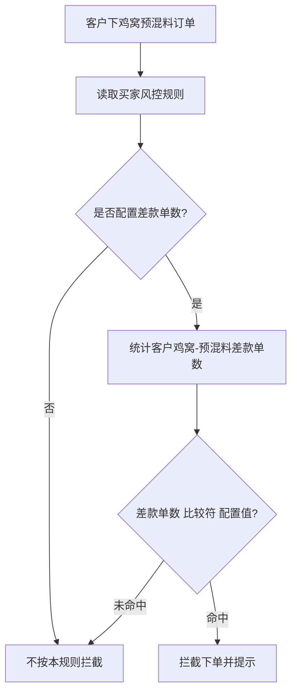
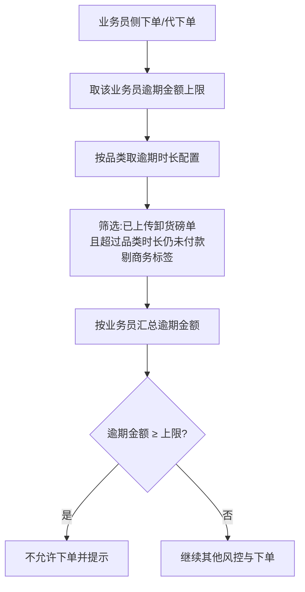
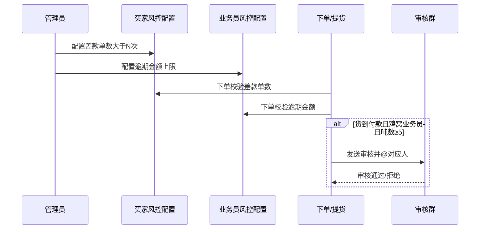

# 【需求】鸡窝风控

| 文档版本 | 日期 | 撰写人 | 修改描述 |
| ---- | ----------- | --- | ------ |
| V1.0 | 2026年09月04日 | AI辅助 | 初稿；对齐 MRD 与已确认 HTML 原型 |

**关联原型**

| 原型文件 | 说明 |
| ---- | ---- |
| `鸡窝风控规则_新增.html` | 交易风控规则配置 · **买家** Tab：差款单数规则新增/查看/编辑 |
| `业务员风控规则_逾期金额控制.html` | 交易风控规则配置 · **业务员** Tab：逾期金额控制列表/新增/编辑/查看 |
| `逾期时长配置.html` | 分品类配置：上传卸货磅单后多久未付款算逾期（豆粕/玉米、预混料） |
| `钉钉卡片-赵璐吨位审核.html` | 5–10吨 · @赵璐 吨位审核卡片（独立保留） |
| `钉钉卡片-东哥吨位审核.html` | >10吨 · @东哥 吨位审核卡片（含养殖数据核对、白条额度） |
| `钉钉卡片-预混料货到付款吨位待审核.html` | 吨位审核卡片（可切换赵璐/东哥；东哥含养殖数据核对） |
| `钉钉卡片-用户运营核实养殖数据.html` | 吨数>10吨：用户运营核实养殖数据卡片（字段同吨位审核卡） |
| `钉钉卡片-提货申请驳回通知.html` | 赵璐/用户运营/东哥驳回后，通知业务员（含驳回原因等） |
| `钉钉卡片-养殖数据有误通知业务员.html` | 用户运营【数据有误】并更正规模后，通知业务员的专用卡片与文案模板 |
| `预混料下单-风控拦截.html` | 预混料下单页：差款单数/逾期金额拦截弹窗；货到付款吨位审核提交后提醒 |
| `提货列表-待审核.html` | 详情·提货 Tab：提货单卡片右上角状态「待审核」 |
| `提货单详情-审核信息.html` | 提货单详情：新增「审核信息」区块（审批类型/提交/审核状态等） |
| `培训文档-鸡窝风控.md` | 业务/审核人培训 SOP（风格对齐客户注册） |

**来源**：`鸡窝风控mrd.md`

---

## 1. 背景和目标

### 1.1 背景

1. 鸡窝预混料下单缺少**差款单数**限制，存在无限制连续下差款订单的风险。
2. 预混料**货到付款**且由鸡窝业务员下单时，大吨位订单缺少分级审核；需按吨数区间进入审核群并 @ 对应审核人，审核通过后再走买家确认提货/匹配库存。
3. 业务员维度缺少**逾期金额**上限管控；名下客户预混料已卸货未付款金额过高时仍可继续下单。

### 1.2 目标

- 买家风控可配置「差款单数」规则，命中后拦截下单。
- 货到付款大吨位订单按吨数走提货审核（5–10 吨 / 10 吨以上不同审核人）。
- 业务员维度可配置逾期金额上限（全量新/老业务员 + 单个业务员），达到上限不允许下单。
- 可按品类配置**逾期时长**（豆粕/玉米、预混料）：上传卸货磅单后超过时长未付款才计入逾期。
- 配置入口统一在「交易风控规则配置」，买家/业务员分 Tab。

### 1.3 受众

| 角色 | 使用场景 |
| ---- | ---- |
| 风控/运营管理员 | 配置买家差款单数、业务员额度与逾期金额 |
| 鸡窝业务员 | 下单时受规则拦截；大吨位货到付款触发审核 |
| 审核人（赵璐 / 东哥） | 接收审核群消息并审核提货单 |
| 买家 | 审核通过后确认提货 / 匹配库存（现网流程） |
| 研发/测试/数据 | 开发、验收、口径对齐 |

### 1.4 名词释义

| 名词 | 说明 |
| ---- | ---- |
| 差款单数 | 客户在「鸡窝-预混料」类目下的差款单据数量（具体表/字段 PRD 与数据口径对齐） |
| 鸡窝-预混料 | 业务类型=鸡窝 且 规则类目=鸡窝-预混料（不按业务员是否鸡窝岗判断） |
| 逾期金额（业务员） | 按业务员汇总：对应品类订单**已上传卸货磅单**、**超过该品类逾期时长仍未付款**的金额合计；**剔除商务标签**订单 |
| 逾期时长 | 自上传卸货磅单起算，超过配置天数仍未付款则判定为逾期；**豆粕/玉米**与**预混料**分别配置 |
| 新/老业务员 | 全量配置维度；对该类型下业务员统一生效（与现网业务员规则一致） |
| 待审核 | 货到付款大吨位订单进入审核后的提货单状态 |
| 商务标签订单 | 带商务标签的订单，不计入逾期金额 |

---

## 2. 需求方案

### 2.1 功能流程图

**A. 买家 · 差款单数拦截**



**B. 货到付款 · 吨位审核**

```mermaid
flowchart TD
  A[预混料下单] --> B{付款类型=货到付款?}
  B -->|否| Z[现网流程]
  B -->|是| C{下单人=鸡窝业务员?}
  C -->|否| Z
  C -->|是| D{下单吨数}
  D -->|小于5吨| Z
  D -->|5吨≤吨数≤10吨| E[提货单=待审核<br/>审核群@赵璐]
  D -->|吨数大于10吨| F[提货单=待审核<br/>审核群@东哥]
  E --> G{审核结果}
  F --> G
  G -->|通过| H[买家确认提货 / 匹配库存]
  G -->|拒绝| I[按现网驳回处理]
```

**C. 业务员 · 逾期金额拦截**



### 2.2 需求列表

| 分类（产品模块） | 主要功能点 | 功能点拆分 | 优先级 |
| -------- | ----- | --------- | -------- |
| Admin·买家风控 | 差款单数规则 | **新增需求：**<br/>规则维度增加「差款单数」<br/>类目固定「鸡窝-预混料」<br/>比较符+数值（次）<br/>列表/查看/编辑/操作日志 | P0 |
| 下单/提货 | 货到付款吨位审核 | **新增需求：**<br/>鸡窝业务员+货到付款+吨数区间<br/>5–10 吨@赵璐；>10 吨@东哥<br/>状态「待审核」→通过后现网后续 | P0 |
| Admin·业务员风控 | 逾期金额控制 | **新增需求：**<br/>列表分列：豆粕/玉米逾期金额、预混料逾期金额<br/>按勾选品类分别配置对应逾期金额（元），**非必填**<br/>全量（新/老业务员）+ 单个业务员<br/>已配置且达上限时拦截下单 | P0 |
| Admin·逾期时长 | 分品类逾期时长 | **新增需求：**<br/>豆粕/玉米、预混料分别配置天数<br/>起算：上传卸货磅单<br/>超时未付款计入逾期金额 | P0 |
| 下单端 | 风控拦截弹窗 | **新增需求：**<br/>差款单数/逾期金额命中拦截（提醒弹窗）<br/>货到付款吨位审核提交后提醒 | P0 |
| 计算引擎 | 逾期金额口径 | **新增需求：**<br/>业务员维度汇总<br/>有卸货磅单 + 超过品类逾期时长 + 未付款<br/>剔除商务标签订单 | P0 |

### 2.3 交互图

**买家差款单数配置**

```
交易风控规则配置 → Tab「买家」 →【+ 新增】/【编辑】
→【+ 添加规则】→ 维度选「差款单数」→ 类目固定鸡窝-预混料 → 比较符/数值(次) →【提交】
→【查看】规则表 + 操作日志
```

**业务员逾期金额配置**

```
交易风控规则配置 → Tab「业务员」 → 筛选业务员【查询】
→【+ 新增】新/老业务员 + 品类限额 + 逾期金额控制 →【提交】
→ 行内【编辑】改限额与逾期金额 →【提交】
→【查看】回显额度与逾期金额控制
```

**逾期时长配置**

```
交易风控规则配置 → 逾期时长配置 → 列表查看豆粕/玉米、预混料时长
→【编辑】修改天数 →【提交】
```

**下单拦截弹窗（预混料下单页）**

```
预混料下单 →【支付定金】/代下单提交
→ 校验差款单数 → 命中：弹窗「提醒」+ 文案 +【我知道了】，不提交
→ 校验业务员对应品类逾期金额 → 命中：同上拦截
→ 双规则命中：并集拦截（演示优先提示差款单数）
→ 货到付款+鸡窝业务员+吨数≥5：可提交，待审核 + 弹窗说明审核中
```

**货到付款审核（业务）**

```
业务员下单(货到付款) → 吨数判定 → 钉钉/企微审核群@审核人
→ 审核通过 → 提货单离开「待审核」→ 买家确认提货或匹配库存
```



---

## 3. 需求明细

| 页面 | 逻辑 |
| ---- | ---- |
| **交易风控规则配置 · 买家**<br/><br/>原型：`鸡窝风控规则_新增.html`<br/><br/>列表列：业务类型、风控类型、创建时间、更新时间、更新人、操作（查看/编辑） | **1. 入口**<br/>Admin · 交易风控规则配置 · Tab「买家」。<br/><br/>**2. 页面字段与规则**<br/>- 业务类型：鸡窝（与现网一致）。<br/>- **新增规则维度：差款单数**（与欠款周期/欠款金额/白条逾期并列）。<br/>- 选中差款单数后：<br/>  - **类目**：固定「鸡窝-预混料」，不可改选。<br/>  - **比较符**：大于 / 大于等于 / 小于 / 等于（沿用现网）。<br/>  - **数值**：必填，单位 **次**。<br/>- 配置示例：`差款单数 ｜ 鸡窝-预混料 ｜ 大于 ｜ [N] 次`。<br/>- 命中：客户在鸡窝-预混料下差款单数满足比较条件 → **拦截下单**。<br/>- 可多条规则；保存、回显、编辑与现有欠款类规则一致。<br/><br/>**3. 操作与跳转**<br/>- 【+ 新增】【编辑】【提交】【取消】【查看】。<br/>- 查看：业务类型条 + 风控规则表（序号/品类/逻辑/更新时间/更新人）+ 操作日志。<br/><br/>**4. 审批流程**<br/>无（配置本身无需审批）。<br/><br/>**5. 消息通知**<br/>无。<br/><br/>**6. 边界与异常**<br/>- 未填数值不可提交。<br/>- 差款单数类目不可改为其他类目。<br/>- 与其他规则同时命中时的优先级：待确认（建议全部拦截条件取并集，任一命中即拦）。<br/><br/>**7. 数据字段**<br/>规则维度=`差款单数`，类目=`鸡窝-预混料`，比较符，阈值(次)，业务类型，更新人/时间，操作日志。 |
| **交易风控规则配置 · 业务员**<br/><br/>原型：`业务员风控规则_逾期金额控制.html`<br/><br/>布局：Tab 行右侧【+ 新增】；Tab 下为业务员筛选（查询/重置）；列表含「豆粕/玉米逾期金额」「预混料逾期金额」列 | **1. 入口**<br/>Admin · 交易风控规则配置 · Tab「业务员」。<br/><br/>**2. 页面字段与规则**<br/><br/>**列表**<br/>\| 列 \| 说明 \|<br/>\| ---- \| ---- \|<br/>\| 业务员名字 \| 单个业务员姓名 \|<br/>\| 更新时间 \| 最后更新时间 \|<br/>\| 豆粕/玉米额度 \| 未配置显示「-」 \|<br/>\| 预混料额度 \| 限额（元） \|<br/>\| **豆粕/玉米逾期金额** \| **新增列**，该品类逾期上限（元） \|<br/>\| **预混料逾期金额** \| **新增列**，该品类逾期上限（元） \|<br/>\| 更新人 \| 如「系统」/操作人 \|<br/>\| 操作 \| 查看、编辑 \|<br/><br/>**新增弹窗「新增业务员规则」**<br/>- 业务员类型：新业务员 / 老业务员（全量配置）。<br/>- 交易品类：豆粕/玉米、预混料（多选，至少一项）；勾选后展示对应限额与逾期金额。<br/>- 豆粕/玉米限额、预混料限额：选中品类时必填，单位元。<br/>- **豆粕/玉米逾期金额 / 预混料逾期金额**：随勾选品类展示，**非必填**，单位元；两品类都勾选时两项均展示；未填不校验该品类逾期上限。<br/>- 已配置且达到对应品类逾期金额上限时，不允许继续下单。<br/><br/>**编辑弹窗**<br/>- 业务员：只读。<br/>- 交易品类、对应限额（必填）；对应品类逾期金额（**非必填**，元）。<br/><br/>**查看弹窗**<br/>- 布局参考现网查看页：业务员类型、业务员（只读输入框）；交易品类（勾选态只读）；按勾选品类展示对应限额与逾期金额（只读，单位元）；无更新时间/更新人。<br/><br/>**逾期金额计算口径（下单校验）**<br/>- 维度：业务员 + 品类。<br/>- 范围：订单**已上传卸货磅单**，且自上传时间起已超过该订单品类对应的**逾期时长**，且**未付款**。<br/>- 品类时长：豆粕/玉米、预混料分别取「逾期时长配置」。<br/>- 剔除：带**商务标签**的订单。<br/>- 判定：该品类汇总逾期金额 **≥** 该品类配置的逾期金额上限 → 拦截下单。<br/><br/>**3. 操作与跳转**<br/>- 【+ 新增】【查询】【重置】【提交】【取消】【查看】【编辑】。<br/><br/>**4. 审批流程**<br/>无。<br/><br/>**5. 消息通知**<br/>无（拦截时前端/接口提示即可）。<br/><br/>**6. 边界与异常**<br/>- 未填逾期金额：该品类不做逾期上限校验。<br/>- 单个业务员与全量（新/老）同时存在时：建议**单个配置优先于全量**（待确认）。<br/>- 上限为 0 是否允许：待确认（建议 ≥0，0 表示有逾期即不可下单）。<br/><br/>**7. 数据字段**<br/>业务员ID/类型、品类限额、overdue_limit、更新人/时间。 |
| **逾期时长配置**<br/><br/>原型：`逾期时长配置.html`<br/><br/>列表固定两行：豆粕/玉米、预混料；列：品类、逾期时长、起算节点、更新时间、更新人、操作 | **1. 入口**<br/>Admin · 交易风控 / 逾期时长配置（可挂在交易风控规则配置下）。<br/><br/>**2. 页面字段与规则**<br/>- **豆粕/玉米**：配置逾期天数（整数，单位：天）。<br/>- **预混料**：独立配置逾期天数。<br/>- **起算节点**：上传卸货磅单时间（固定，不可改）。<br/>- 判定：`当前时间 - 卸货磅单上传时间 ≥ 配置天数` 且仍未付款 → 该单计入逾期金额统计。<br/>- 天数须为 **≥0 的整数**；0 表示上传卸货磅单后未付款即算逾期。<br/><br/>**3. 操作与跳转**<br/>- 行内【编辑】→ 修改天数 →【提交】/【取消】。<br/><br/>**4. 审批流程**<br/>无。<br/><br/>**5. 消息通知**<br/>无。<br/><br/>**6. 边界与异常**<br/>- 未配置时长：待确认（建议必须配置默认值，禁止空）。<br/>- 改时长后是否回溯历史单：建议**实时按新时长重算**。<br/><br/>**7. 数据字段**<br/>category（soy_corn / premix）、overdue_days、start_node=卸货磅单上传、更新人/时间。 |
| **货到付款吨位审核**<br/><br/>原型：`钉钉卡片-预混料货到付款吨位待审核.html`、`提货列表-待审核.html`、`提货单详情-审核信息.html` | **1. 入口**<br/>预混料下单提交成功后的提货/审核链路；审核群收到钉钉工作通知卡片；详情页 · 提货 Tab 列表展示状态；提货单详情展示审核信息。<br/><br/>**2. 触发条件（同时满足）**<br/>- 品类：预混料；<br/>- 付款类型：货到付款；<br/>- 下单人：鸡窝业务员；<br/>- 吨数：<br/>  - **5 吨 ≤ 吨数 ≤ 10 吨**：审核人 **赵璐**；<br/>  - **吨数 > 10 吨**：审核人 **东哥**；<br/>  - **吨数 < 5 吨**：不走本审核，现网流程。<br/><br/>**3. 提货单/订单状态**<br/>- **新增状态文案：待审核**（卡片右上角主状态，橙色；副文案按审核人展示「（待赵璐审核）」或「（待东哥审核）」，交互对齐现网「待匹配（待物流匹配库存）」）。<br/>- 命中吨位审核规则后，提货单进入「待审核」，审核通过后再走买家确认提货 / 匹配库存；拒绝按现网驳回。<br/>- 「执行中」列表中可同时存在「待审核」与其他现网状态单据。<br/>- 列表卡片字段、操作按钮（更多/转发/修改金额）与现网客户详情·提货 Tab 一致。<br/><br/>**4. 提货单详情 · 审核信息（新增）**<br/>- 位置：提货信息与辅助操作记录之间（无审核记录时本区块可不展示，待确认；本期原型有审核即展示）。<br/>- 字段：<br/>  - 审批类型：固定「提货吨数超过5吨」<br/>  - 提交时间<br/>  - 提交人<br/>  - 审核状态：待审核 / 已通过 / 已拒绝（等）<br/>  - 审核人：赵璐或东哥<br/>  - 审核时间：未审核时显示「--」<br/>- 展示样式：左对齐「标签：值」行（对齐现网辅助操作记录类信息样式）。<br/><br/>**5. 卡片字段与操作（钉钉 · 吨位审核）**<br/>- 展示分块：<br/>  - **客户信息**：客户名称、客户类型（养殖户/次终端）；养殖户另展示养殖类型、养殖规模，次终端不展示；是否白条客户；若白条客户=是，另增<strong>平台最高可用额度</strong>、<strong>当前可用额度</strong>（赵璐/东哥卡片均需）；吨数&gt;10吨（@东哥）另增<strong>养殖数据核对</strong>=已经核实一致<br/>  - **订单信息**：提货单号、商品名称、付款类型、合同金额、合同包数、下单吨数、下单时间<br/>  - **业务员信息**：业务员、站台<br/>- 状态「待审核」（审核人通过群消息 @ 体现，卡片内不展示审核人字段）。<br/>- 群消息文案 @ 对应审核人。<br/>- 操作：【通过】【拒绝】（也可仅提醒 + 跳转审核页，研发选型）。<br/>- <strong>驳回通知业务员</strong>：赵璐 / 用户运营 / 东哥任一驳回提货申请后，向业务员发送工作通知。原型：`钉钉卡片-提货申请驳回通知.html`。字段：提货单编号、客户名称、商品名称、提货吨数、驳回原因、驳回人、驳回时间。标题：提货申请驳回通知；@对应业务员。<br/><br/>**5.1 钉钉 · 用户运营核实养殖数据（吨数>10吨）**<br/>- 原型：`钉钉卡片-用户运营核实养殖数据.html`<br/>- 标题：**预混料下单吨数超过10吨，核实养殖数据**<br/>- 字段分块与吨位审核卡片一致（客户信息 / 订单信息 / 业务员信息）。<br/>- 状态：待核实 → 已核实 / 数据有误。<br/>- 操作：【数据有误】【核实通过】。<br/>- 【数据有误】：须在卡片内重新填写正确养殖规模后提交；提交后回写档案规模并通知业务员；状态变为「数据有误」。<br/>- 【核实通过】：无需改规模，状态变为「已核实」。<br/>- 建议先核实通过后再推东哥审核；东哥卡片展示「养殖数据核对：已经核实一致」。<br/><br/>**6. 审批流程**<br/>见上；审核人名单建议可配置，避免写死姓名（待确认）。<br/><br/>**7. 消息通知**<br/>钉钉审核群卡片 + @审核人。<br/><br/>**8. 边界与异常**<br/>- 恰为 5 吨、10 吨边界：按闭区间归属（5–10 含两端归赵璐；>10 归东哥）。<br/>- 非鸡窝业务员或非货到付款：不触发。<br/><br/>**9. 数据字段**<br/>订单吨数、付款类型、下单人角色、提货单状态=`待审核`、审批类型、提交时间/人、审核人、审核结果/时间。 |
| **预混料下单 · 风控拦截弹窗**<br/><br/>原型：`预混料下单-风控拦截.html`<br/><br/>样式对齐现网「提醒」弹窗（标题+文案+橙色主按钮） | **1. 入口**<br/>预混料下单页（买家自下 / 业务员代下）点击【支付定金】或等价提交动作时校验。<br/><br/>**2. 拦截规则与弹窗文案**<br/><br/>\| 场景 \| 是否允许提交 \| 弹窗文案（建议） \| 按钮 \|<br/>\| ---- \| ---- \| ---- \| ---- \|<br/>\| 差款单数命中 \| 否 \| 当前客户鸡窝-预混料差款单数已超过风控限制，不能下单，请先处理差款订单后再试 \| 我知道了 \|<br/>\| 业务员对应品类逾期金额 ≥ 上限（已配置） \| 否 \| 当前业务员预混料逾期金额已达上限，不能下单，请先催收回款或联系管理员调整规则（豆粕/玉米下单换对应品类文案） \| 我知道了 \|<br/>\| 多规则同时命中 \| 否 \| 并集拦截；可优先展示差款单数提示（待确认是否逐条展示） \| 我知道了 \|<br/>\| 货到付款吨位需审核 \| 是（提交成功） \| 订单已提交。本次货到付款吨数需审核（提货单状态：待审核），审核通过后再进行买家确认提货或匹配库存 \| 我知道了 \|<br/>\| 非养殖户货到付款且无生效中白条 \| 否 \| 货到付款的预混料订单需要开通生效中的白条才可下单 \| 我知道了 \|<br/><br/>**3. 操作与跳转**<br/>- 【我知道了】关闭弹窗，停留当前下单页；不跳转（跳转差款列表/催收页待确认）。<br/><br/>**4. 审批流程**<br/>拦截场景无审批；吨位审核见上表。<br/><br/>**5. 消息通知**<br/>前端弹窗提醒；吨位审核另发钉钉卡片。<br/><br/>**6. 边界与异常**<br/>- 未配置差款/逾期规则：不弹对应拦截。<br/>- 校验顺序建议：差款单数 → 逾期金额 →（通过后）提交 → 吨位审核分流。<br/><br/>**7. 数据字段**<br/>命中规则类型、提示文案、客户差款单数、业务员逾期金额与上限。 |

---

## 4. 边界/异常场景

| 场景 | 处理 |
| ---- | ---- |
| 差款单数与白条/欠款规则同时命中 | 建议任一命中即拦截；提示可展示命中规则摘要 |
| 业务员无配置逾期金额 | 待确认：不校验 / 或走全量新老默认 |
| 单个业务员与全量规则冲突 | 建议单个优先 |
| 卸货磅单后退款/部分付款 | 逾期金额按「未付款余额」还是整单：待数据确认（建议未付金额） |
| 商务标签事后打标 | 打标后是否从逾期中剔除：建议实时口径重算 |
| 审核人请假/变更 | 审核人建议配置化，本期可先按 MRD 姓名落地 |
| 吨数修改后是否重审 | 待与提货域确认 |
| 风控规则能否删除 | MRD 存疑；买家原型现为查看/编辑，删除策略沿用现网 |

---

## 5. 数据统计

### 5.1 核心指标

| 指标名称 | 定义 | 计算口径 | 统计周期 | 备注 |
| ---- | --- | ---- | ---- | --- |
| 差款单数拦截次数 | 因差款单数规则拦截下单次数 | count(拦截且规则含差款单数) | 日 | |
| 逾期金额拦截次数 | 因业务员逾期上限拦截次数 | count(逾期拦截) | 日 | |
| 吨位审核发起数 | 进入待审核的单量 | count(状态=待审核且本规则触发) | 日 | 可按 5–10 / >10 拆分 |
| 吨位审核通过率 | 通过数/发起数 | 通过 / 发起 | 周 | |
| 业务员逾期金额分布 | 各业务员当前逾期金额 | 按口径汇总 | 日 | 风控看板可选 |

### 5.2 埋点（建议）

| 事件 | 触发 | 关键属性 |
| ---- | ---- | ---- |
| risk_diff_order_block | 差款单数拦截 | 客户ID、差款单数、阈值、比较符 |
| risk_overdue_block | 逾期金额拦截 | 业务员ID、逾期金额、上限 |
| risk_ton_audit_start | 进入吨位审核 | 订单号、吨数、审核人 |
| risk_ton_audit_result | 审核结果 | 订单号、通过/拒绝、审核人 |
| risk_sales_overdue_save | 保存业务员逾期配置 | 业务员/类型、上限值 |

### 5.3 关键字段/口径汇总

| 对象 | 字段/口径 |
| ---- | ---- |
| 差款单数规则 | dim=差款单数，category=鸡窝-预混料，op，value(次) |
| 业务员逾期上限 | overdue_limit（元） |
| 逾期金额实时值 | SUM(已卸货磅单 + 超品类逾期时长 + 未付款金额)，按业务员，剔除商务标签；豆粕/玉米与预混料分别套用各自时长 |
| 逾期时长配置 | soy_corn.overdue_days、premix.overdue_days（天），起算=卸货磅单上传时间 |
| 吨位审核 | ton、pay_type=货到付款、sales_role=鸡窝业务员、auditor、status=待审核 |

### 5.4 外部系统对接

| 系统 | 说明 |
| ---- | ---- |
| 下单/提货域 | 拦截校验、状态「待审核」、审核通过后现网流转 |
| 差款/提货短溢等相关表 | 差款单数统计来源（待数据确认表名） |
| 卸货磅单、付款状态、商务标签 | 逾期金额口径 |
| 钉钉/企微审核群 | 发送审核消息并 @ 审核人 |

---

## 6. 附录

### 6.1 全局约束

1. 鸡窝预混料判定：**业务类型=鸡窝 + 类目=鸡窝-预混料**，不是按岗位名称猜测。
2. 差款单数类目**固定不可改**。
3. 逾期金额按**业务员**汇总；须同时满足：已上传卸货磅单、超过对应品类**逾期时长**、未付款；剔商务标签；达上限禁下单。
4. 逾期时长：**豆粕/玉米**与**预混料**分品类配置，起算节点为上传卸货磅单。
5. 货到付款吨位审核仅适用于鸡窝业务员 + 预混料 + 货到付款 + 吨数≥5。

### 6.2 待确认项

| 项 | 说明 | 建议 |
| ---- | ---- | ---- |
| 差款单取数表 | 差款单/提货短溢等 | 与数据同学对齐后补附录 |
| 多规则冲突 | 并集拦截 vs 优先级 | 并集拦截 |
| 单个 vs 全量逾期配置 | 优先级 | 单个优先 |
| 未付款定义 | 全款未付 / 尚有应付余额 | 尚有应付余额 |
| 审核人是否配置化 | MRD 写死赵璐/东哥 | 二期配置化，一期可写死 |
| 规则删除能力 | MRD 疑问 | 沿用现网 |
| 吨位审核原型 | 已有 `钉钉卡片-预混料货到付款吨位待审核.html` | 卡片内操作 vs 仅跳转审核页待确认 |

### 6.3 风险控制

- 口径偏差会导致误拦或漏拦，上线前需用历史订单抽样对账。
- 审核依赖即时通讯 @，需确认群机器人权限与审核人账号映射。
- 全量新/老业务员配置影响面大，提交前建议二次确认文案（可选）。
